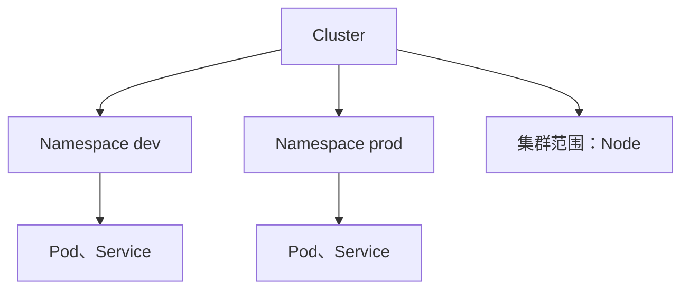

## Q
**Namespaces · 摘要**｜摘要 · 必会

Kubernetes 的 Namespace 是什么？它和 Linux 的 namespace 是一回事吗？不同命名空间里的对象能互相访问吗？

## A
**一句话：** Kubernetes Namespace 是把一个集群里的对象分成逻辑分组，名字只需在组内唯一。它和第 1 部分讲的 Linux namespace 是两回事，也不是隔离。



| 问题 | 回答 |
|---|---|
| 作用 | 分组；同名对象可以在不同命名空间各有一个；可以对整个命名空间做权限和配额 |
| 默认就有 | `default`、`kube-system`（系统组件）、`kube-public`、`kube-node-lease` |
| 能互访吗 | 默认能。Pod 网络是平的，不同命名空间的 Pod 照样能连；要拦截需要 NetworkPolicy（第 4 部分） |
| 跨命名空间访问 Service | 用 `<服务名>.<命名空间>`，如 `db.prod` |
| 不属于命名空间的对象 | Node、Namespace 本身等（集群范围） |
| 删除命名空间 | 里面所有对象一起被删 |

```bash
kubectl get pods -n kube-system     # 指定命名空间
kubectl get pods -A                 # 所有命名空间
kubectl create namespace dev
```

- **所以：** 命名空间是组织和授权的边界，不是网络或安全的边界。

**出处：** KIA2 §7.1（Organizing objects into Namespaces）；Poulton ch5
