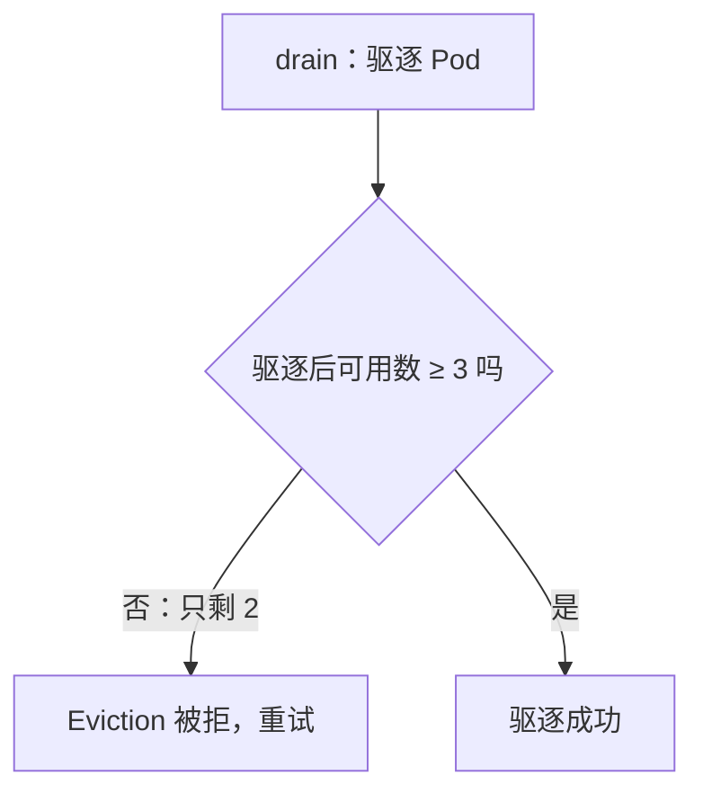

## Q
**drain 卡住了**｜考点 · 必会

一个 Deployment 有 3 个副本，PDB 写了 `minAvailable: 3`。升级 node 时执行 `kubectl drain node-1` 一直不结束。为什么？怎么改才合理？

## A

| 配置 | 副本 3 时允许同时被驱逐 | 结果 |
|---|---|---|
| `minAvailable: 3` | 0 个 | 任何驱逐都违反预算，drain **永远卡住** |
| `minAvailable: 2` 或 `maxUnavailable: 1` | 1 个 | drain 一个一个驱逐，每次等新 Pod 就绪再继续 |
| `minAvailable: "50%"` | 3 × 50% = 1.5，向上取整为 2 个必须可用，允许驱逐 1 个 | 同上 |

- **PDB 不能写成「一个都不许动」：** 这会让每次 node 维护、集群缩容都卡住，运维只好绕过它。
- **只有 1 个副本的应用：** 设 `minAvailable: 1` 同样让 drain 卡死；要么多开副本，要么接受短暂中断，不设 PDB。
- **PDB 保护不了的：** 副本数本身就是 1，node 突然宕机（involuntary disruption）；PDB 只管主动驱逐。
- **为不健康的 Pod 留出路：** 文档建议给 PDB 设 `unhealthyPodEvictionPolicy: AlwaysAllow`，否则应用本身已不健康时，drain 会一直等它们恢复。
- **和滚动更新无关：** Deployment 的更新节奏由它自己的 `maxUnavailable` 控制，不受 PDB 限制。

出处

kubernetes.io Concepts › Disruptions（Eviction API、drain 重试、AlwaysAllow 建议）；Tasks › Specifying a Disruption Budget（minAvailable/maxUnavailable、百分比向上取整）

