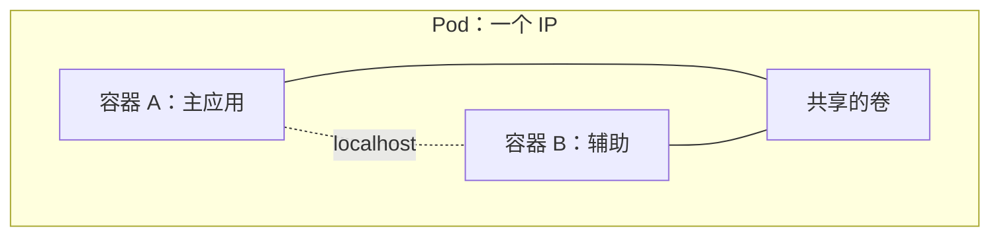

## Q
**Pod 是什么 · 先修**｜先修 · 必会

Kubernetes 为什么不直接调度一个个容器，而要多包一层 Pod？一个 Pod 里的几个容器共享什么？

## A
**一句话：** Pod 是调度和运行的最小单位，里面有一个或几个容器，它们一定在同一台 node 上，共享网络和（可选的）存储。

| 共享 | 说明 |
|---|---|
| 网络 | 同一个 IP、同一组端口；容器之间用 `localhost` 互访 |
| IPC | 可以用共享内存等方式通信 |
| 卷（volume） | 把同一个目录挂进多个容器 |
| 不共享 | 文件系统和进程默认各自独立，镜像、CPU/内存限制也按容器单独设 |

- **何时放进同一个 Pod：** 它们紧密耦合，必须在同一台机器上一起启动、一起扩缩、一起消失。典型是一个主应用加一个辅助容器（反向代理、日志收集），这个辅助容器叫 **sidecar**。
- **何时分开：** 能独立扩缩的部分（前端和数据库）要放进不同的 Pod。
- **为什么要这层：** 对 Kubernetes 来说，调度、IP、重建的最小粒度是 Pod；容器只是 Pod 里的一部分，不能单独被列出来（`kubectl get pods` 能列，没有 `get containers`）。

**出处：** KIA2 §5.1（Understanding pods）、§5.1.3
