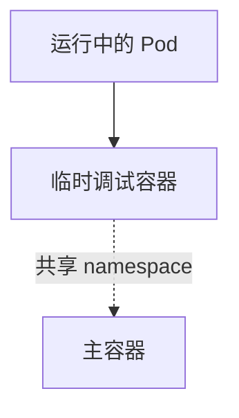

## Q
**与 Pod 交互**｜摘要 · 必会

一个 Pod 出了问题，排障时最先用到的四个 kubectl 动作是什么？各看什么？

## A
| 动作 | 命令 | 看什么 / 做什么 |
|---|---|---|
| 看日志 | `kubectl logs <pod>` | 容器写到 stdout/stderr 的内容 |
| 指定容器 | `kubectl logs <pod> -c <容器>` | 多容器 Pod 要指定 |
| 看崩溃前的日志 | `kubectl logs <pod> --previous` | 已经重启过的容器，上一次运行的输出 |
| 进去看 | `kubectl exec -it <pod> -- sh` | 在容器里开一个 shell 或跑一条命令 |
| 本机访问 | `kubectl port-forward pod/<pod> 8080:8080` | 把本机 8080 转到 Pod 的 8080，不暴露给别人 |
| 临时调试容器 | `kubectl debug -it <pod> --image=busybox --target=<容器>` | 给运行中的 Pod 临时加一个带工具的容器 |

- **ephemeral container：** 临时调试容器。不能用来跑应用，不会重启，Pod 重建后就没了。
- **为什么需要：** 很多生产镜像不带 shell 和调试工具，`exec` 进去什么也干不了；`debug` 能带来工具，还能 `--target` 加入同一个进程 namespace 看到主容器的进程。
- **port-forward：** 经过 API server 转发，适合临时调试，不是对外服务的方式。

出处

KIA2 §5.3（Interacting with pods）；kubernetes.io Tasks › Debug Running Pods

