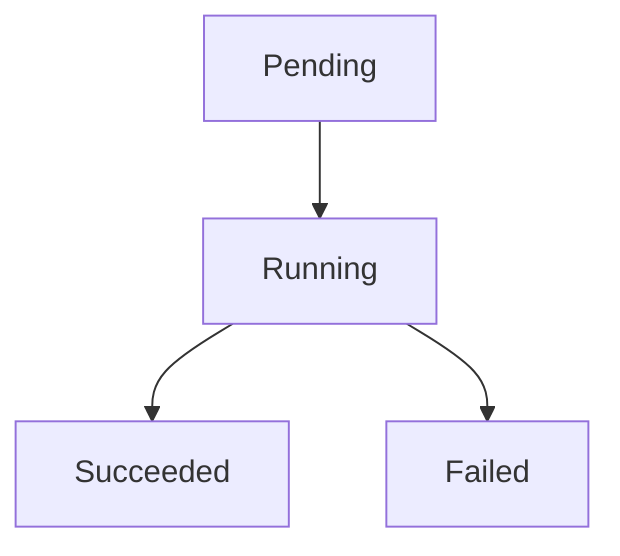

## Q
**Pod status**｜摘要 · 必会

`kubectl get pods` 显示 `Running`，是不是说明应用可以用了？Pod 的 phase、conditions、container states 各是什么？

## A
**不是。** Running 只表示 Pod 已经分配到 node，至少有一个容器在运行或正在启动。能不能接流量要看 **Ready** 这个 condition。

| 层次 | 取值 | 回答什么 |
|---|---|---|
| **phase** | Pending / Running / Succeeded / Failed / Unknown | Pod 在生命周期的哪一段 |
| **conditions** | PodScheduled、Initialized、ContainersReady、Ready | 一组具体的是/否检查，带原因 |
| **container state** | Waiting / Running / Terminated | 每个容器自己的状态，带 reason（如 CrashLoopBackOff） |

- **Pending：** 还没分配 node，或者 node 在拉镜像。
- **Succeeded / Failed：** 所有容器都结束（全部成功，或有失败）。Job 的 Pod 会到这里。
- **Ready：** 所有容器的 readiness probe 通过，Service 才会把流量送给它。
- **READY 列 `0/1`：** 一个容器，还没就绪。
- **要看原因：** `kubectl describe pod` 里的 Conditions 和每个容器的 State、Last State。

出处

KIA2 §6.1（Understanding the pod's status）；kubernetes.io Concepts › Pod Lifecycle

