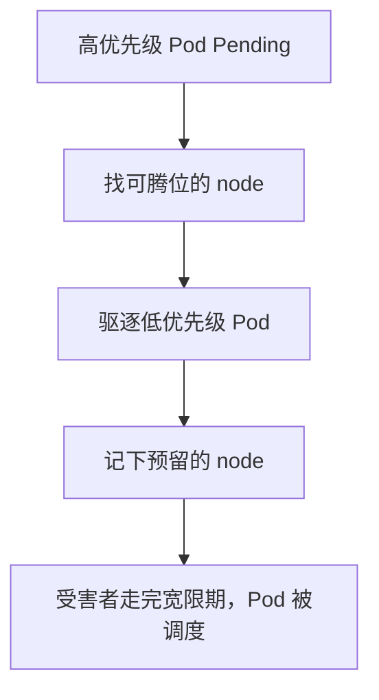

## Q
**PriorityClass、preemption 与 PDB · 摘要**｜摘要 · 必会

集群资源不够时，谁先让路？计划内的维护（drain node）又怎么保证应用不会被一次踢光？

## A
**两件事处理两种压力：**

| | 谁在受压 | 机制 | 一句话 |
|---|---|---|---|
| **PriorityClass + preemption** | 新 Pod 放不下 | scheduler 找一个 node，驱逐若干**低优先级** Pod 给高优先级 Pod 腾位置 | 按重要性让路 |
| **PodDisruptionBudget（PDB）** | 计划内的驱逐 | 限制同时有多少个 Pod 可以被**主动**驱逐 | 维护时保住最低可用数 |



**PriorityClass** 是不属于任何 namespace 的对象：`value`（整数，用户可设的最大是 10 亿）、`globalDefault`、`preemptionPolicy`（默认 `PreemptLowerPriority`；设成 `Never` 则排队靠前但不抢别人）。系统自带 `system-cluster-critical` 和 `system-node-critical`（值更大，留给系统 Pod）。Pod 用 `priorityClassName` 引用，没写就是 0（除非有 globalDefault）。

```yaml
apiVersion: policy/v1
kind: PodDisruptionBudget
metadata: {name: web-pdb}
spec:
  minAvailable: 4            # 或 maxUnavailable，二选一
  selector:
    matchLabels: {app: web}
```

| PDB 要点 | 说明 |
|---|---|
| 约束的是 | **voluntary disruption**（主动驱逐：drain node、集群缩容等），经 Eviction API |
| 约束不了 | **involuntary**（硬件故障、node 失联等），但它们会计入预算 |
| `kubectl drain` | 通过 Eviction API 逐个驱逐，被 PDB 拒绝时重试到超时 |
| 比例 | `minAvailable: "50%"` 向上取整；`maxUnavailable` 的百分比也向上取整 |
| 不限制 | Deployment 的滚动更新不受 PDB 限制 |

**出处：** kubernetes.io Concepts › Pod Priority and Preemption；Disruptions；Tasks › Specifying a Disruption Budget
