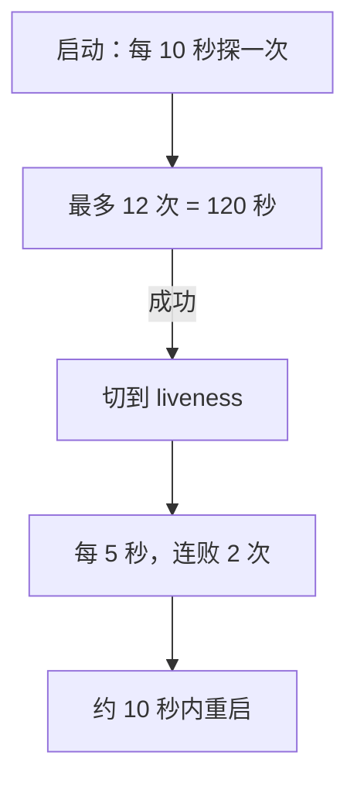

## Q
**Startup + liveness 配置 · 考点**｜考点 · 必会

一个应用冷启动要约 100 秒，稳定运行后希望卡死 10 秒内被重启。下面的配置合适吗？启动阶段最多等多久？运行中多久发现故障？

```yaml
startupProbe:
  httpGet: {path: /, port: http}
  periodSeconds: 10
  failureThreshold: 12
livenessProbe:
  httpGet: {path: /, port: http}
  periodSeconds: 5
  failureThreshold: 2
```

## A


| 阶段 | 计算 | 结果 |
|---|---|---|
| 启动 | 10 秒 × 12 次 | 最多等 **120 秒**，够 100 秒的冷启动 |
| 运行 | 5 秒 × 2 次 | 约 **10 秒**判定不健康，然后重启 |

- **启动阶段 probe 失败是正常的**，只表示还没起来；用完 12 次还失败，才像 liveness 失败那样重启容器。
- **只有 liveness 会怎样：** 默认设置只给应用二三十秒启动，100 秒的应用会被反复重启，进入循环。把 liveness 放宽（拉高 `failureThreshold`）又会让运行中的故障发现得很慢，这就是要 startup probe 的原因。
- **周期乘次数：** `periodSeconds × failureThreshold` 越大，故障发现越慢；两个阶段分开配，各取所需。

**出处：** KIA2 §6.2.6（startup probe 示例：10 秒 × 12 次 = 120 秒；liveness 5 秒 × 2 次）
