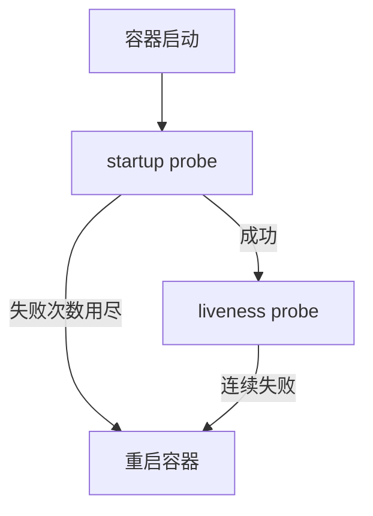

## Q
**Probe 设计**｜摘要 · 必会

给一个 Web 服务写 liveness probe 的 handler 时，有哪些规则能避免「probe 本身把应用搞垮」？

## A
| 规则 | 原因 |
|---|---|
| **只检查自己内部**（如 `/healthz` 查内部组件），不要因为后端挂了就返回失败 | 重启前端修不好后端，只会反复重启，依赖链长时引发连锁故障 |
| handler **不要鉴权** | 需要登录的话 probe 永远失败，容器被不停重启 |
| **要轻**：默认每次只给 1 秒，占的 CPU 和内存算在容器的配额里 | 重量级 handler 会挤占主进程；Java 应用别用 exec 起一整个 JVM，改用 HTTP GET |
| **不要在 handler 里自己写重试循环** | 用 `failureThreshold` 调高，让 probe 连续失败几次才算不健康 |
| 能保证应用不健康时自己退出，可以不配 liveness | 写错的 liveness 比没有更糟：健康的应用也会被重启 |
| 慢启动应用配 **startup probe** | 启动期只跑 startup probe，成功后才切换到 liveness |

- **最简单也有用：** 只检查 HTTP 服务器还能响应 `/`，也比没有 liveness 强，因为卡死的进程会被重启。
- **和 readiness 的分工：** 外部依赖暂时不可用，用 readiness 让流量绕开，不要重启。

出处

KIA2 §6.2.6–6.2.7「Using a startup probe…」「Creating effective liveness probe handlers」

