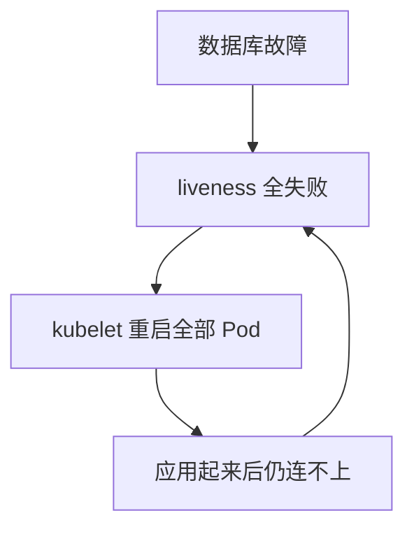

## Q
**Probes 与 restart policy**｜考点 · 必会

容器一直崩溃，`kubectl get pods` 显示 `CrashLoopBackOff`。kubelet 重启的间隔怎么变？还有一个相关问题：你给每个 Pod 的 liveness probe 加了「检查数据库连得上」，数据库故障时会发生什么？

## A
**重启间隔：** 第一次重启没有延迟，然后 10 秒，之后每次翻倍，**最多 5 分钟**。容器正常运行满 10 分钟（上限的两倍）后，延迟重置为零。

| 重启次数 | 重启前等待 |
|---|---|
| 第 1 次 | 无 |
| 第 2 次 | 10 秒 |
| 第 3 次 | 20 秒 |
| 第 4 次 | 40 秒 |
| 之后 | 继续翻倍，封顶 5 分钟 |

- **liveness 检查外部依赖是坑：** 数据库一挂，所有副本同时被判死、同时被重启，重启也修不好数据库，还把本来能工作的部分搞垮。
- **正确分工：** liveness 只检查「这个进程自己卡死了没有」；依赖是否可用，交给 readiness（让流量暂时绕开），不重启。
- **慢启动的应用：** 用 startup probe，避免 liveness 在启动阶段误杀。

出处

KIA2 §6.2、ch6 小结（重启延迟 10 秒起翻倍，封顶 5 分钟）

