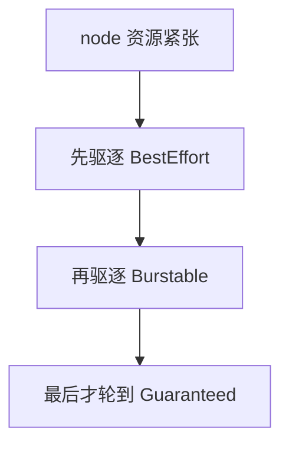

## Q
**Requests、limits 与 QoS · 摘要**｜摘要 · 必会

容器的 `requests` 和 `limits` 各管什么？QoS class 又是怎么由它们决定的？

## A
**一句话：** `requests` 是「我至少需要这么多」，**调度器**据此挑 node；`limits` 是「最多只让用这么多」，由 **kubelet 和内核**（cgroup）强制执行。

```yaml
resources:
  requests: {cpu: 500m, memory: 256Mi}   # 调度用：500 毫核 = 0.5 个核
  limits:   {cpu: "1",  memory: 512Mi}   # 封顶
```

| | requests | limits |
|---|---|---|
| 谁用 | scheduler：node 上剩余量要装得下 | cgroup：运行时封顶 |
| 超出的后果 | 调度不进去（Pending） | CPU：被**限速**；内存：被 **OOM kill** |

| QoS class | 条件 | 被驱逐的顺序 |
|---|---|---|
| **Guaranteed** | 每个容器的 CPU 和内存 request 都等于 limit（且大于 0） | 最后 |
| **Burstable** | 不是 Guaranteed，但至少设了一个 request 或 limit | 中间 |
| **BestEffort** | 一个 request、limit 都没设 | 最先 |



- **`m`：** 毫核，`500m` 是半个 CPU 核。
- **node 压力下：** 只有用量超过 requests 的 Pod 才是驱逐候选。

**出处：** kubernetes.io Concepts › Resource Management for Pods and Containers；Pod Quality of Service Classes
