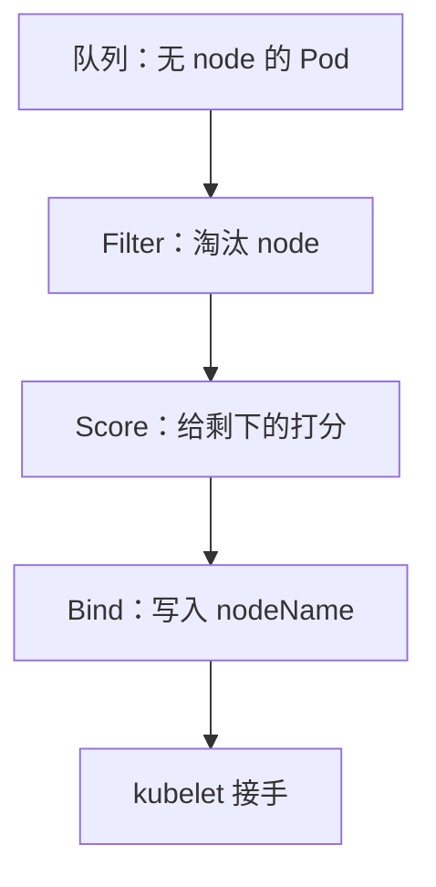

## Q
**Scheduling cycle · 摘要**｜摘要 · 必会

scheduler 怎么为一个新 Pod 挑 node？它本身是不是也遵循 controller 那套逻辑？

## A
**一句话：** scheduler 盯着「还没分配 node 的 Pod」，对每个 Pod 走一遍：**过滤**掉装不下的 node，给剩下的**打分**，选分最高的，最后**绑定**（把 node 名写进 Pod）。

| 步骤 | 做什么 | 例子 |
|---|---|---|
| Filter | 淘汰不满足硬条件的 node | 剩余 CPU/内存不够 requests；有 taint（排斥标记）而 Pod 不容忍；端口冲突 |
| Score | 给通过的 node 打分 | 已有镜像、剩余资源多、Pod 分布均匀 |
| Bind | 把选中的 node 写到 Pod 上 | 之后 kubelet 看到「分配给我的 Pod」 |

- **都没通过：** Pod 保持 Pending，Events 里写明每类原因（如「0/3 nodes are available: 3 Insufficient cpu」）。
- **scheduler 也是 controller 式的：** 它 watch API server 里没有 nodeName 的 Pod，把结果写回 API server，不直接联系 kubelet。
- **它只看 requests：** 不看 node 上的实际使用量。

**出处：** Poulton ch2「The scheduler」；kubernetes.io Concepts › Kubernetes Scheduler
