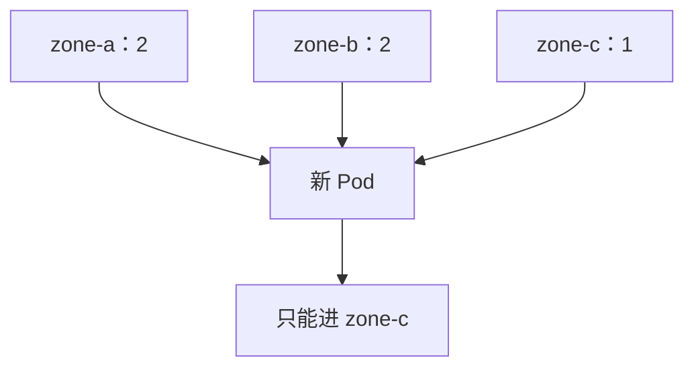

## Q
**Skew 计算 · 考点**｜考点 · 必会

三个可用区里匹配的 Pod 数量是 zone-a 2 个、zone-b 2 个、zone-c 1 个。新建一个 Pod，约束是 `maxSkew: 1`、`topologyKey: topology.kubernetes.io/zone`、`whenUnsatisfiable: DoNotSchedule`。它能放进哪些 zone？换成 `ScheduleAnyway` 呢？

## A
**skew = 某 zone 的匹配 Pod 数 − 全局最小值。** 放之前最小值是 1（zone-c）。

| 假设放进 | 放后数量 | 最小值 | 该 zone 的 skew | 是否 ≤ 1 |
|---|---|---|---|---|
| zone-a | 3, 2, 1 | 1 | 3 − 1 = 2 | 否 |
| zone-b | 2, 3, 1 | 1 | 2 | 否 |
| zone-c | 2, 2, 2 | 2 | 0 | 是 |

- **`DoNotSchedule`（默认）：** 只能放 zone-c，若 zone-c 没资源，Pod 就 `Pending`，不会去破坏均衡。
- **`ScheduleAnyway`：** 不拒绝，只是给能降低 skew 的 zone 更高的分，仍会优先 zone-c，但 zone-c 放不下时可以放别处。
- **`labelSelector`：** 决定「哪些 Pod 算同类」来计数；滚动更新时新旧 ReplicaSet 的 Pod 标签不同，可用 `matchLabelKeys`（如 `pod-template-hash`）只和同一批的 Pod 比。
- **`minDomains`：** 可用的 zone 少于它时，全局最小值当作 0，逼着集群扩出更多 zone。
- **注意：** `topologyKey` 的 label 必须所有 node 上都有，缺的话会出现意外的调度结果。

**出处：** kubernetes.io Concepts › Pod Topology Spread Constraints（字段说明与 2/2/1 示例）
