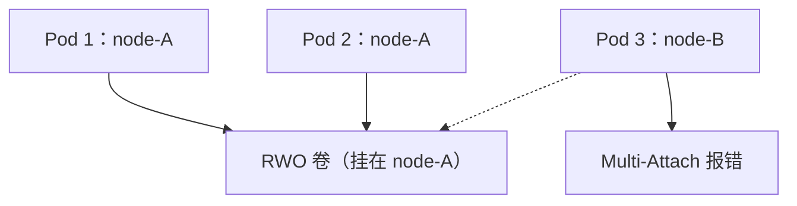

## Q
**Multi-Attach 与 Released · 考点**｜考点 · 必会

两个现象：1）同一个 RWO 的 PVC 被 5 个 Pod 使用，3 个 Running，2 个卡在 `ContainerCreating`，事件里有 `Multi-Attach error`。2）static 的 PV（`Retain`）在 PVC 删掉重建后，新 PVC 和 Pod 一直 Pending。分别为什么？

## A
| 现象 | 原因 | 处理 |
|---|---|---|
| 1. Multi-Attach | RWO 只允许卷**挂在一个 node 上**；调度到同一个 node 的 Pod 都能用，落在别的 node 的 Pod 挂不上 | 用 RWX（存储支持的话）；或让这些 Pod 都调度到同一个 node（pod affinity）；每个副本各用一个 PVC（StatefulSet 的做法）；要「同时只能一个 Pod 用」则选 RWOP |
| 2. PVC 一直 Pending | PV 状态是 **Released**，不是 Available：里面可能还有旧数据，也还记着旧 claim | 确认数据没用后，删除并重建 PV（数据在底层存储里，不会丢），或编辑 PV 去掉 `claimRef` |

- **RWO 与 RWOP 的差别：** RWO 按 node 限制，RWOP 按 Pod 限制；第二个 RWOP 用户一直 Pending。
- **排查：** `kubectl describe pod` 看事件（`FailedAttachVolume`），`kubectl get pv` 看 STATUS 和 CLAIM 列。

**出处：** KIA2 §10.2.4（Multi-Attach error）、§10.3.3（Released 后无法重新绑定；删除并重建 PV 或移除 claimRef）
