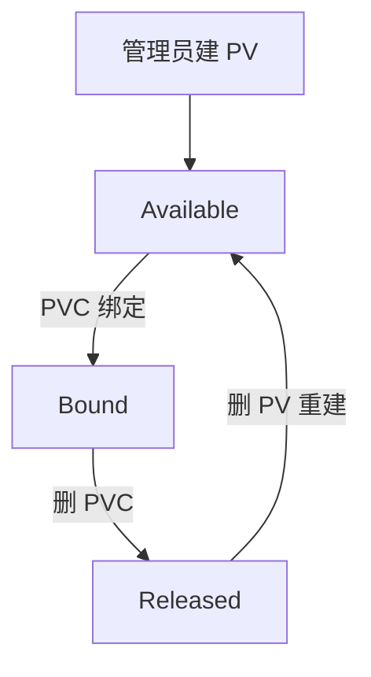

## Q
**Access modes、reclaim policy 与 static provisioning · 摘要**｜摘要 · 必会

PVC 里的 `accessModes` 四个值各是什么意思？删掉 PVC 之后，PV 和里面的数据去哪了？

## A
| access mode | 含义 |
|---|---|
| `ReadWriteOnce`（RWO） | 一个 **node** 可以挂载读写；同一个 node 上的多个 Pod 都能用 |
| `ReadWriteOncePod`（RWOP） | 只有一个 **Pod** 能用；第二个用同一个 PVC 的 Pod 会一直 Pending |
| `ReadOnlyMany`（ROX） | 多个 node 可以只读挂载 |
| `ReadWriteMany`（RWX） | 多个 node 可以读写挂载（要存储本身支持，如文件存储） |

| reclaim policy | 删除 PVC 后 |
|---|---|
| `Delete` | PV 和底层存储一起被删（dynamic provisioning 通常是这个） |
| `Retain` | PV 变成 **Released**，保留数据，等管理员处理（static provisioning 常用） |

- **static provisioning：** 管理员先建好 PV（如 node 本地盘），用户再写 PVC 认领；动态供给则是先有 PVC，provisioner 再创建 PV。
- **Released 的 PV 不会自动再绑**：里面可能还有上一个用户的数据。要复用：删掉并重建 PV 对象（只是一个指向存储的指针，数据不丢），或编辑 PV 去掉 `claimRef`。
- **删 PV 不删底层存储：** 静态供给的盘要手动清理，避免产生费用。
- **克隆：** PVC 的 `dataSourceRef` 可以指向另一个 PVC，用它的内容初始化新卷，不论访问模式。

**出处：** KIA2 §10.2.3–10.2.4、§10.3.1–10.3.3
