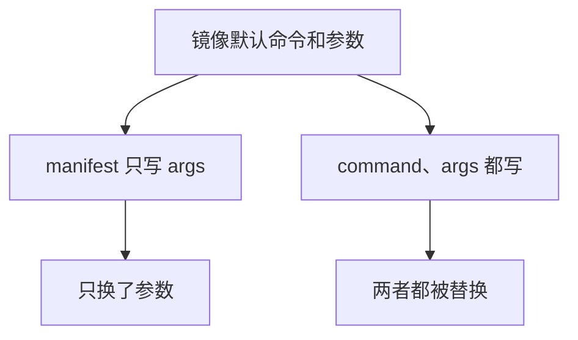

## Q
**command、args 与 env**｜摘要 · 必会

不重新构建镜像，怎么改容器启动时跑的命令、参数和环境变量？Dockerfile 里的 `ENTRYPOINT` 和 `CMD` 对应 Pod manifest 里的哪些字段？

## A
| Dockerfile | Pod manifest | 含义 |
|---|---|---|
| `ENTRYPOINT` | `command` | 要执行的程序（通常只有可执行文件） |
| `CMD` | `args` | 传给这个程序的参数 |

最终命令 = `command` 数组 + `args` 数组拼接。分成两个字段，所以可以只改参数、不动程序。



```yaml
containers:
- name: kiada
  image: luksa/kiada:0.4
  command: ["node", "--cpu-prof", "app.js"]   # 替换 ENTRYPOINT
  args: ["--listen-port", "9090"]             # 替换 CMD
  env:
  - name: INITIAL_STATUS_MESSAGE              # 环境变量：字面值
    value: "hello"
```

- **环境变量按容器设置**，没法给整个 Pod 设一组让所有容器继承。值可以是字面值，也可以引用别的变量，或来自 ConfigMap、Secret、Downward API。
- **YAML 陷阱：** 数组里的 `1234`、`true`、`yes`、`no`、`on`、`off`、`null` 这类会被解析成别的类型，要加引号。
- **只改其中一个：** 只写 `args`，沿用镜像的 ENTRYPOINT；只写 `command`，也会让镜像的 `CMD` 失效，参数需要自己补。

<details class="pt" markdown="1"><summary>出处</summary>

KIA2 §8.1.1–8.1.2（command/args 与 ENTRYPOINT/CMD；env 按容器设置；YAML 引号提示）

</details>
