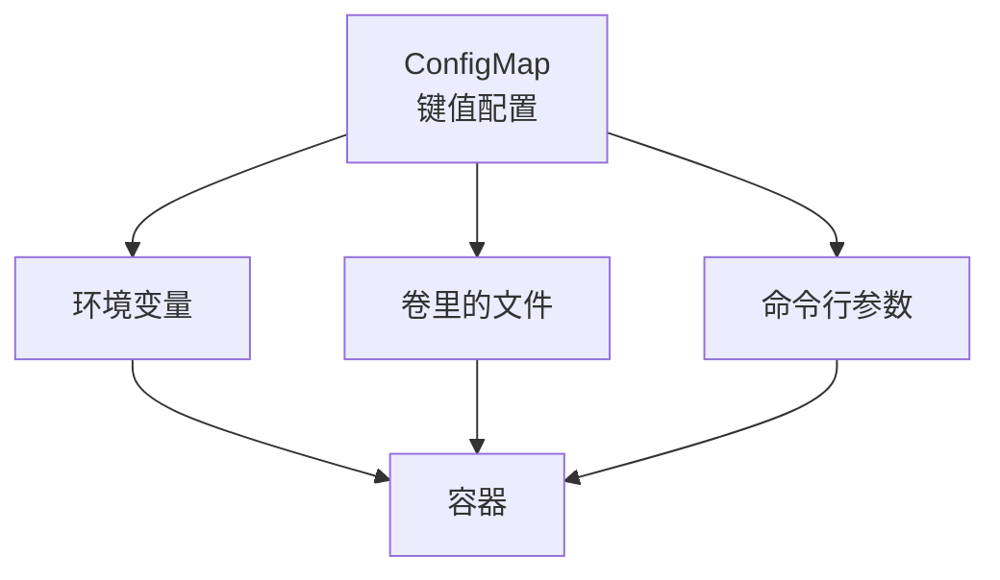

## Q
**ConfigMap · 摘要**｜摘要 · 必会

同一个镜像要在开发和生产用不同的配置（数据库地址、日志级别）。为什么不把配置写死在镜像或 Pod manifest 里？Kubernetes 提供什么办法，配置怎么送进容器？

## A
**一句话：** **ConfigMap** 是一个存放键值配置的独立对象。Pod 引用它，配置和 Pod manifest 解耦：同一份 manifest，在不同环境引用不同的 ConfigMap。

```yaml
apiVersion: v1
kind: ConfigMap
metadata: {name: kiada-config}
data:
  status-message: "Hello from dev"
  log-level: "debug"
```



| 送进容器的方式 | 写法 |
|---|---|
| 环境变量 | `env[].valueFrom.configMapKeyRef`，或 `envFrom` 一次性导入全部键 |
| 文件（卷） | `volumes` 里引用 ConfigMap，挂载到容器目录，每个键一个文件 |
| 命令行参数 | 先设成环境变量，再在 `args` 里用 `$(NAME)` 引用 |

```bash
kubectl create configmap kiada-config --from-literal=log-level=debug
kubectl get configmap kiada-config -o yaml
```

- **为什么解耦：** 改配置不用重新构建镜像，也不用改 Pod manifest；一个 ConfigMap 可以被多个 Pod 共用。
- **大小：** 放配置，不放大文件。

**出处：** KIA2 §8.2（Using ConfigMaps to configure applications）
