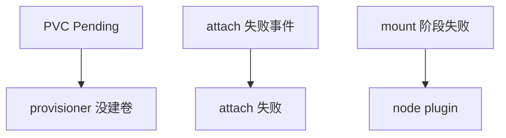

## Q
**卡在哪一步**｜考点 · 必会

三种现象：A）PVC 一直 `Pending`，没有 PV 出现。B）PV 有了、PVC 也 Bound，Pod 卡在 `ContainerCreating`，事件有 `FailedAttachVolume`。C）卷挂上了但 Pod 卡在 mount 阶段。分别该查 CSI 的哪一部分？

## A

| 现象 | 对应环节 | 去查 |
|---|---|---|
| A. 没有 PV | 创建卷（`external-provisioner`） | StorageClass 的 `provisioner` 名对不对、CSI controller Pod 在不在、日志；PVC 的 `describe` 事件；`WaitForFirstConsumer` 模式下要先有 Pod 才会供给 |
| B. FailedAttachVolume | 把卷挂到 node（`external-attacher`） | 是不是 RWO 卷还挂在另一个 node（Multi-Attach）；云盘数量上限；controller 日志 |
| C. 卡在 mount | **node plugin**（kubelet 调用） | 该 node 上的 CSI node Pod 是否在运行、`node-driver-registrar` 有没有注册成功、kubelet 日志 |

- **分层的好处：** 看事件名就能定位是 controller 侧还是 node 侧出了问题。
- **先看：** `kubectl describe pvc`、`kubectl describe pod` 的事件，再看 `kubectl -n <csi 所在 namespace> logs` 对应组件。

出处

KIA2 §10.2.5–10.2.6（StorageClass、volumeBindingMode、CSI driver）；kubernetes-csi.github.io（controller 与 node 组件分工）

