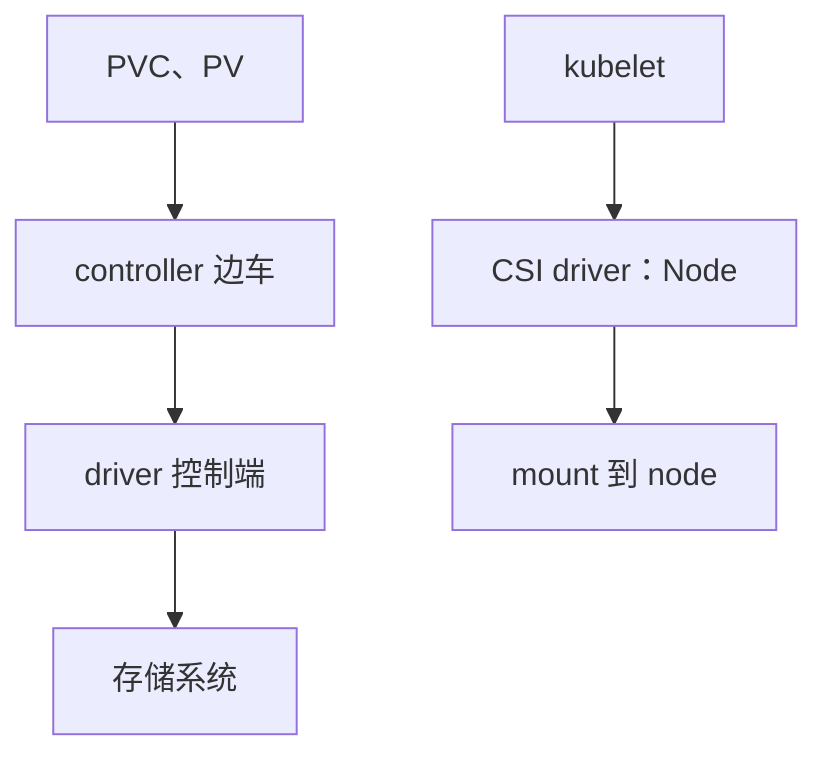

## Q
**CSI 架构**｜摘要 · 必会

PVC 创建后，是哪些组件把一块真实的盘变成容器里的目录？CSI driver 里为什么分 controller 和 node 两部分？

## A
**从零说起：** **CSI**（Container Storage Interface）是 Kubernetes 和存储系统之间的标准接口。早期 Kubernetes 的代码里直接带着各种存储的支持，现在都挪到了独立的 **CSI driver** 里（out-of-tree），新增存储不用改 Kubernetes。

| 部分 | 怎么部署 | 做什么 |
|---|---|---|
| **controller plugin** | Deployment 或 StatefulSet，可多副本（选主，同时只一个活跃） | 创建和删除卷、attach / detach、快照、扩容，调用存储的 API |
| **controller sidecars** | 与 driver 在同一个 Pod | `external-provisioner`（看到 PVC 就创建卷和 PV）、`external-attacher`、`external-snapshotter`、`external-resizer`：监听 Kubernetes 对象，再调 driver |
| **node plugin** | **DaemonSet**（每个 node 一个 Pod） | 在 node 上 mount、unmount |
| **node-driver-registrar** | 与 node plugin 同 Pod | 把 driver 注册给 kubelet |

- **sidecar 与 driver 怎么说话：** 共享一个 UNIX socket（用 emptyDir 卷）。kubelet 通过 hostPath 共享的 socket 调用 node 的 CSI 服务。
- **`CSIDriver` 对象：** `kubectl get csidrivers` 列出已装的 driver；它的名字就是 StorageClass 里的 `provisioner`。
- **所以分两部分：** 创建卷是对存储系统的操作，不需要在 node 上；mount 必须在用卷的那个 node 上做。

出处

KIA2 §10.2.6「About CSI drivers」；kubernetes-csi.github.io Developer Documentation › Deploying CSI Driver on Kubernetes、Sidecar Containers

