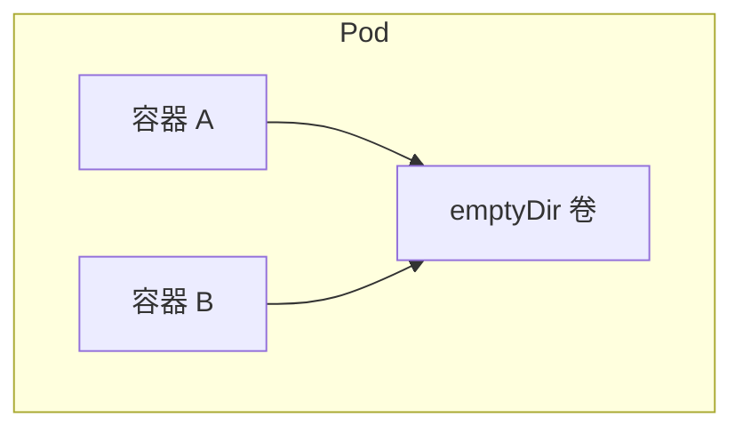

## Q
**Volumes 与 emptyDir · 摘要**｜摘要 · 必会

容器重启后，它文件系统里写的文件就没了。想让文件在容器重启后还在，或者让同一个 Pod 里两个容器共享文件，怎么做？

## A
**一句话：** 容器的文件系统是临时的：容器一重建，里面写的东西就没了。**Volume** 是 Pod 级的目录，挂进容器后，容器重启它还在。



```yaml
spec:
  volumes:
  - name: shared
    emptyDir: {}
  containers:
  - name: app
    image: kiada:1.0
    volumeMounts:
    - {name: shared, mountPath: /data}
  - name: shipper
    image: log-shipper:1.0
    volumeMounts:
    - {name: shared, mountPath: /logs}
```

| 事件 | emptyDir 里的文件 |
|---|---|
| 容器崩溃重启 | **还在** |
| Pod 被删除、重建 | **没了**，新 Pod 得到新的空目录 |
| 同 Pod 里别的容器 | 能共享 |
| 别的 Pod | 不能共享 |

- **生命周期：** 卷绑定的是 **Pod**，不是容器。
- **用途：** 容器重启后保留数据；容器根文件系统设成只读时，给它一个能写的临时目录；多个容器之间共享数据。
- **要跨 Pod 保存数据：** 用 PersistentVolume（下一章）。

**出处：** KIA2 §9.1–9.2（Using an emptyDir volume）
