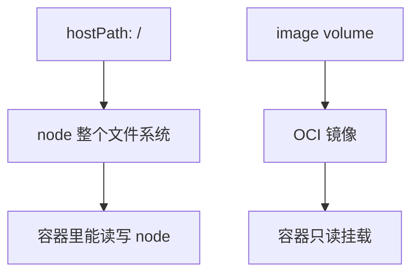

## Q
**hostPath 与 image volume · 摘要**｜摘要 · 必会

想让容器读 node 上的文件，或者把一批预先准备好的数据（比如模型权重）以文件形式交给容器，各用哪种 volume？风险和限制是什么？

## A
| | hostPath | image volume |
|---|---|---|
| 内容来源 | **node 本机**的某个文件或目录 | 一个 **OCI 镜像或制品**里的文件 |
| 读写 | 读写 | **只读** |
| 数据跟着什么 | 跟着 node：Pod 换了 node，看到的内容就不同 | 跟着镜像，哪个 node 拉到的都一样 |
| 风险 | **最危险的 volume 类型之一**，给了就等于给了 node 上的权限 | 低 |
| 典型用途 | 系统级 Pod 读 node 日志、设备 | 分发模型权重、静态资源、预置数据 |

```yaml
volumes:
- name: initdb
  image:
    reference: luksa/quiz-questions:latest   # 一个只含数据文件的 OCI 镜像
    pullPolicy: Always
```



- **hostPath 不适合放数据库数据**，除非 Pod 永远在同一个 node 上；node 本地数据要持久用 local PersistentVolume。
- **谁能用：** 应限制为 privileged、系统级的 Pod；普通用户不该能用 hostPath。
- **image volume 的好处：** 数据和主镜像分开打包、分开发版本，不用在主镜像里塞大文件，也不用 init 容器复制。
- **其他 volume 类型：** 云盘等已被 CSI 取代，用 PersistentVolume 的 claim 引用。

**出处：** KIA2 §9.3「Mounting a container image as a volume」、§9.4「Accessing files on the worker node's filesystem」
