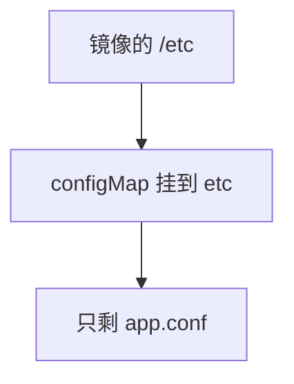

## Q
**挂载吃掉目录 · 考点**｜考点 · 必会

你把一个只含 `app.conf` 的 ConfigMap 以 volume 挂到容器的 `/etc`，应用起来就报「找不到 `/etc/passwd` 之类的文件」。为什么？有哪几种补救办法，各有什么代价？

## A
**原因：** 挂载 volume 到某个目录，镜像里原有在这个目录里的文件（包括子目录）都**看不到了**，只剩 volume 里的内容。

| 办法 | 做法 | 代价 |
|---|---|---|
| 挂到专用目录 | 如 `/etc/app/`，应用从这里读配置 | 最简单，需要应用支持配置路径 |
| `subPath` | 只挂单个文件，如把 `app.conf` 挂到 `/etc/app.conf` | 这样挂载的文件**不会随 ConfigMap 更新而变** |
| 多个来源要进同一目录 | 用 `projected` 卷合并 | 要写 projected 的 sources |

- **正常 configMap 卷的更新：** 内容变化后，卷里的文件会通过符号链接**原子更新**，应用能看到新文件（需要应用自己重新读取）；环境变量不会更新。
- **所以：** 想要热更新就不要用 `subPath`；要保留 `/etc` 其他文件就用专用子目录。

**出处：** KIA2 §9.5.2「How configMap volumes work」；§9.5.6（subPath 不随更新、projected 卷）
