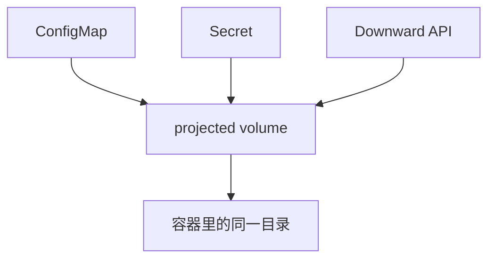

## Q
**configMap、Secret、downwardAPI 与 projected 卷**｜摘要 · 必会

配置要以**文件**形式给容器，有哪几种 volume 类型？projected 卷又解决什么问题？

## A
| volume 类型 | 来源 | 典型用途 |
|---|---|---|
| `configMap` | ConfigMap 的每个条目变成一个文件 | 大的、多行的配置文件（如 `envoy.yaml`） |
| `secret` | Secret 的条目变成文件 | TLS 证书、私钥 |
| `downwardAPI` | Pod 元数据 | Pod 名、labels |
| **`projected`** | 以上几种（还有 ServiceAccount token）**合并到一个目录** | 一个目录里同时要配置、证书、元数据 |



```yaml
volumes:
- name: cert-and-key
  secret:
    secretName: kiada-tls
    items:                  # 只挑需要的键，并改文件名
    - {key: tls.crt, path: example-com.crt}
    - {key: tls.key, path: example-com.key}
```

- **环境变量 vs 文件：** 环境变量适合小的单行值；长的多行内容用文件。ConfigMap 和 Secret 的内容受 etcd 限制，大约在 1 MB 量级。
- **不用 projected 的话**，没法把几个不同来源的文件放进同一个目录；用 `subPath` 可以挑单个文件，但这样挂载的文件**不会随源更新**。
- **权限：** configMap 和 secret 卷里文件默认是 `0644`；Secret 建议收紧（`defaultMode`），同时要设对组归属，否则进程读不了。
- **配置与镜像分开：** 配置、证书放在 ConfigMap 和 Secret 里，换配置不用重新构建镜像。

<details class="pt" markdown="1"><summary>出处</summary>

KIA2 §9.5.1–9.5.6

</details>
