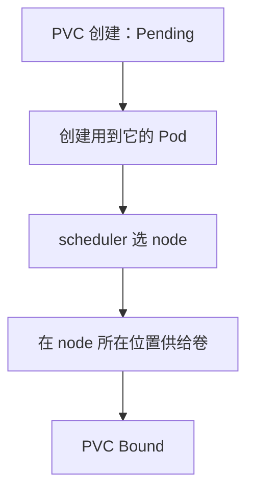

## Q
**PV、PVC 与 StorageClass**｜考点 · 必会

你创建了一个 PVC，StorageClass 的 `volumeBindingMode` 是 `WaitForFirstConsumer`。`kubectl get pvc` 显示 `Pending`，已经好几分钟。是出问题了吗？什么时候才会变成 `Bound`？为什么要这样设计？

## A
**不一定出问题。** `WaitForFirstConsumer` 的意思是：PVC 创建后先不供给卷，等**第一个使用它的 Pod 被调度**时才供给。

| `volumeBindingMode` | 什么时候创建并绑定卷 |
|---|---|
| `Immediate` | PVC 一创建就供给 |
| `WaitForFirstConsumer` | 第一个用它的 Pod 被调度时 |

- **为什么：** 云硬盘这类存储通常只能挂到同一个可用区的 node。如果卷先建好、位置固定，调度器可能得把 Pod 放在卷所在区，选择受限，甚至没有地方放。等 Pod 先被调度，再在 Pod 所在位置建卷，就不会错位。
- **这一步卡住怎么查：** 有没有 Pod 在用这个 PVC；`describe pvc` 看 Events。
- **PVC 的关系：** PVC 在命名空间里，PV 是集群范围；绑定后一一对应。

出处

KIA2 §10.2（volumeBindingMode：Immediate 与 WaitForFirstConsumer）

