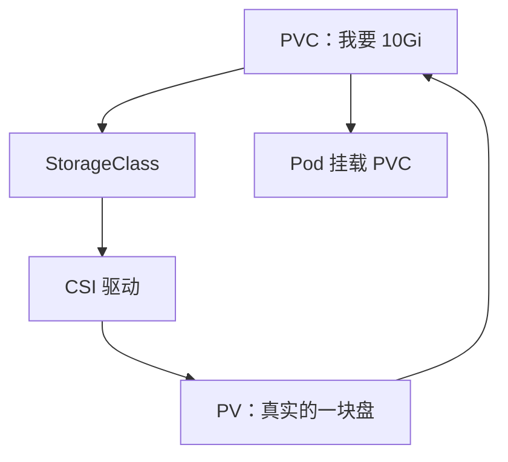

## Q
**PV、PVC 与 StorageClass**｜摘要 · 必会

开发者想要「10Gi 的磁盘」，却不想知道底层是云硬盘还是 NFS。Kubernetes 里 PersistentVolume、PersistentVolumeClaim、StorageClass 各是什么？

## A
**一句话：** 开发者用 **PVC** 声明「我要什么」，**StorageClass** 说明「用哪种方式提供」，**PV** 是真正提供出来的一块存储。



| 对象 | 谁创建 | 是什么 |
|---|---|---|
| **PersistentVolume（PV）** | 管理员，或动态供给时自动 | 集群里的一块存储，不属于任何命名空间 |
| **PersistentVolumeClaim（PVC）** | 开发者 | 对存储的申请：大小、访问模式、StorageClass；属于命名空间 |
| **StorageClass** | 管理员 | 一类存储的模板：用哪个 provisioner、参数、绑定时机 |

```yaml
apiVersion: v1
kind: PersistentVolumeClaim
metadata: {name: quiz-data}
spec:
  accessModes: [ReadWriteOnce]
  storageClassName: standard
  resources:
    requests: {storage: 10Gi}
```

- **动态供给（dynamic provisioning）：** 创建 PVC 时，provisioner 按 StorageClass 自动创建底层存储和 PV，绑定到 PVC；不用管理员预先建好。
- **Pod 里：** 在 `volumes` 里引用 `persistentVolumeClaim.claimName`，像普通卷一样挂载。
- **CSI 驱动：** 具体存储技术的实现，通常有一个 controller 部分负责创建卷，每个 node 上有一个部分负责挂载、卸载。

<details class="pt" markdown="1"><summary>出处</summary>

KIA2 §10.1–10.2（PersistentVolumes、dynamic provisioning、CSI drivers）

</details>
