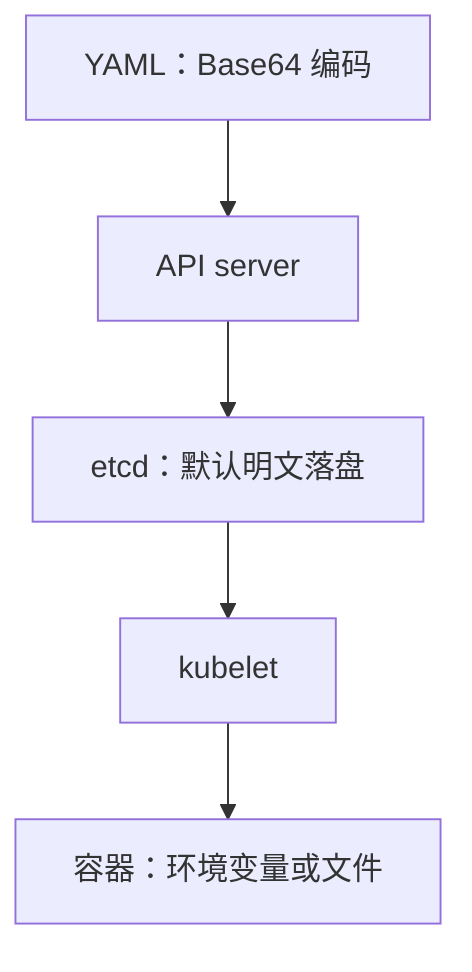

## Q
**Secret**｜摘要 · 必会

同事说「我们的数据库密码放在 Secret 里，是加密的，很安全」。这句话对吗？一个 Secret 从 YAML 到容器里，每一处是明文还是密文？

## A
**不对。** Secret 里的值只是 **Base64 编码**，不是加密。任何有权读取这个 Secret 的人都能一行命令解开。

```bash
echo 'cGFzc3dvcmQ=' | base64 -d      # 输出：password
```



| 位置 | 状态 |
|---|---|
| manifest / `kubectl get secret -o yaml` | Base64，等于明文 |
| etcd | 默认**不加密**存储；要另外开启静态加密（encryption at rest，可接 KMS） |
| 谁能读 | 由 RBAC 控制：权限配松了，别人就能通过 API 读到 |
| 容器里 | 环境变量或文件，应用被攻破或把环境变量写进日志就泄露 |
| 轮换 | Kubernetes 不自动轮换，只会在 Secret 更新后同步卷里的文件 |

- **更稳妥的做法：** 开启 etcd 静态加密；收紧 RBAC；用外部的密钥管理工具（如 HashiCorp Vault）补足加密、细粒度权限、自动轮换和审计。
- **所以 Secret 比 ConfigMap 好在哪：** 单独授权、可以单独加密存储，不是因为值本身被加密了。

<details class="pt" markdown="1"><summary>出处</summary>

KIA2 §8.3（Secrets 的真实安全性：encoded, not encrypted；stored unencrypted unless encryption enabled）

</details>
