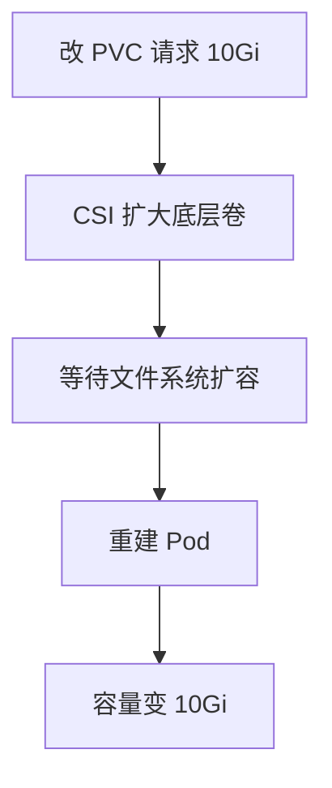

## Q
**扩容后还是旧大小 · 考点**｜考点 · 必会

你把 PVC 的 `requests.storage` 从 1Gi 改成 10Gi，`kubectl apply` 成功了，但 `kubectl get pvc` 的 CAPACITY 仍是 1Gi。哪里不对？你又试图把它缩回 5Gi 呢？

## A

| 现象 | 说明 |
|---|---|
| CAPACITY 还是 1Gi | `kubectl describe pvc` 的 Conditions 里有 `FileSystemResizePending`：等待**重新启动使用它的 Pod**，才在 node 上扩文件系统。删除并让 controller 重建 Pod，就变成 10Gi |
| 扩容被拒绝 | StorageClass 没开 `allowVolumeExpansion`，`apply` 会直接报错 |
| 缩到 5Gi | **不支持**，卷只能增大 |
| 想换 StorageClass | `storageClassName` 不可改，要新建 PVC；PVC 的 spec 创建后基本不可变，除了请求的大小（和 `volumeAttributesClassName`） |

- **扩容失败怎么办：** v1.34 起（GA）可以取消不被底层存储支持的扩容，改一个更小的请求重试，不再卡死。
- **看 CAPACITY 列：** 它显示**已绑定卷的实际大小**，不是 PVC 请求的大小。

**出处：** KIA2 §10.4.1（FileSystemResizePending；只能增大；PVC spec 不可变）；kubernetes.io 发布博客 v1.34（Recovery from volume expansion failure GA，KEP #1790）
