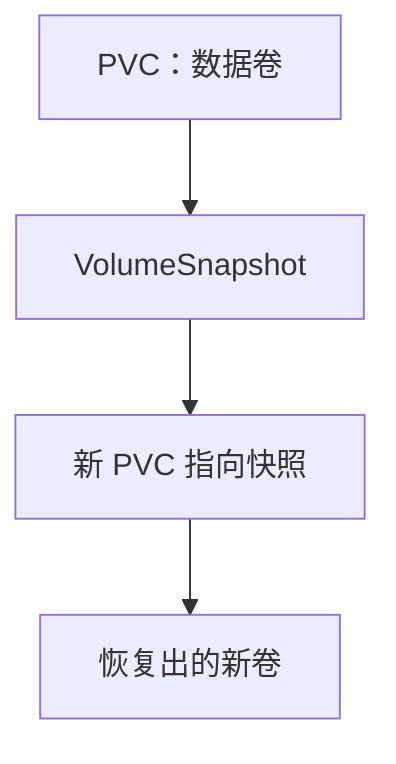

## Q
**Resize、VolumeSnapshot 与 ephemeral volume**｜摘要 · 必会

PVC 创建之后，还能怎么管理它：改大小、做快照、从快照恢复？「ephemeral volume」又和 emptyDir 有什么区别？

## A
| 操作 | 怎么做 | 要点 |
|---|---|---|
| **扩容** | 改 PVC 的 `spec.resources.requests.storage` | StorageClass 要允许扩容（`allowVolumeExpansion`）；**只能加，不能减**；PVC 的 spec 其他字段创建后基本不可改 |
| **快照** | 建 `VolumeSnapshot`，指向 PVC 和 `VolumeSnapshotClass` | 由 CSI driver 做，实际快照由 `VolumeSnapshotContent` 表示 |
| **恢复** | 新建 PVC，`dataSource` 指向这个 VolumeSnapshot | 得到一个有快照数据的新卷 |
| **克隆** | 新 PVC 的 `dataSourceRef` 指向已有 PVC | 不论访问模式 |

```yaml
apiVersion: snapshot.storage.k8s.io/v1
kind: VolumeSnapshot
metadata: {name: quiz-data-1}
spec:
  volumeSnapshotClassName: pd-csi
  source:
    persistentVolumeClaimName: quiz-data
```



**ephemeral volume**：Pod 里写 `ephemeral.volumeClaimTemplate`，创建 Pod 时按模板建一个**只给这个 Pod 用**的 PVC，生命周期随 Pod。和 emptyDir 相比：

| | emptyDir | ephemeral volume |
|---|---|---|
| 大小上限 | 没有固定上限（可以超） | 有固定大小，超不了 |
| 能做什么 | 临时目录 | 是正常的 PV，能做快照、克隆、扩容；可以是本地盘也可以是网络盘 |

<details class="pt" markdown="1"><summary>出处</summary>

KIA2 §10.4.1–10.4.3、§10.5.1–10.5.2

</details>
