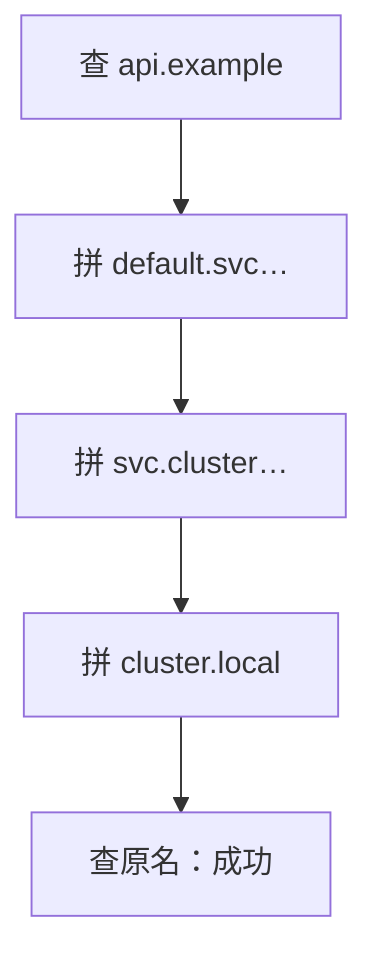

## Q
**ndots:5 · 考点**｜考点 · 必会

Pod 里的应用频繁访问外部域名 `api.example.com`，DNS 延迟偏高，集群 DNS 的查询量也很大。`resolv.conf` 里是 `options ndots:5` 和三个搜索域。为什么？怎么缓解？

## A
**原因：** `api.example.com` 只有 2 个点，少于 5，resolver 会当成「可能是短名字」，先逐个拼上搜索域去查，都失败了才查原名。

| 查询 | 结果 |
|---|---|
| `api.example.com.default.svc.cluster.local` | 不存在 |
| `api.example.com.svc.cluster.local` | 不存在 |
| `api.example.com.cluster.local` | 不存在 |
| `api.example.com` | 成功 |

一次解析变成 4 次查询，前 3 次白费（每种记录类型都要各查一遍）。

| 缓解办法 | 做法 |
|---|---|
| 写完整名字 | 结尾加点：`api.example.com.`，不再拼搜索域 |
| 调低 ndots | Pod 的 `dnsConfig.options` 里设 `ndots: 2` |
| 缓存 | 在 node 上或应用里缓存 DNS 结果 |

- **逐层排查：** 先在 Pod 里 `nslookup <服务名>`（DNS 对不对）→ 再看 Service 有没有后端（EndpointSlice）→ 再看 Pod 是否 Ready。
- **为什么是 5：** 为了让集群内 `svc.ns.svc` 之类的多级短名字也能补全，代价是外部域名多查几次。

**出处：** Poulton ch9（resolv.conf 的 search 与 `ndots:5`、troubleshooting）；resolver 对 ndots 的处理见 resolv.conf(5)
