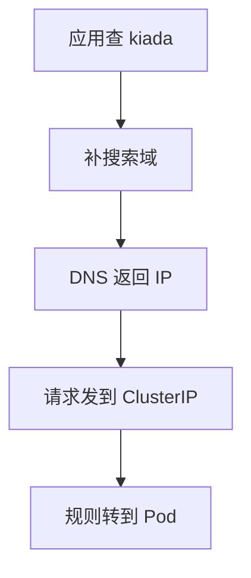

## Q
**Service discovery 与 CoreDNS**｜摘要 · 必会

应用代码里只写了 `http://kiada`，它怎么变成一个 IP？容器里的 `/etc/resolv.conf` 里写了什么？

## A
**一句话：** 每个容器都被配置成向集群 DNS（**CoreDNS**）问路；Service 创建时，集群 DNS 里就有了它的名字；Pod 的 resolv.conf 里的**搜索域**把短名字补成完整名字。

```bash
cat /etc/resolv.conf
search default.svc.cluster.local svc.cluster.local cluster.local
nameserver 10.96.0.10          # 集群 DNS（kube-dns Service）的 ClusterIP
options ndots:5
```



| 名字 | 解析成 |
|---|---|
| `kiada`（同命名空间） | 补成 `kiada.default.svc.cluster.local` |
| `kiada.prod` | 补成 `kiada.prod.svc.cluster.local` |
| 完整名字 | 直接解析 |

- **Service registry：** 集群 DNS 就是服务注册表：Service 一创建就有记录，一删除就没有。
- **ClusterIP 没有路由：** 容器把发往它的流量交给 node，node 内核里 kube-proxy 写的规则把它改成某个健康 Pod 的 IP。
- **ndots:5：** 名字里点的个数少于 5 时，会先逐个尝试搜索域，下一张卡讲它的代价。

<details class="pt" markdown="1"><summary>出处</summary>

Poulton ch9（「Service discovery」、/etc/resolv.conf 示例）

</details>
