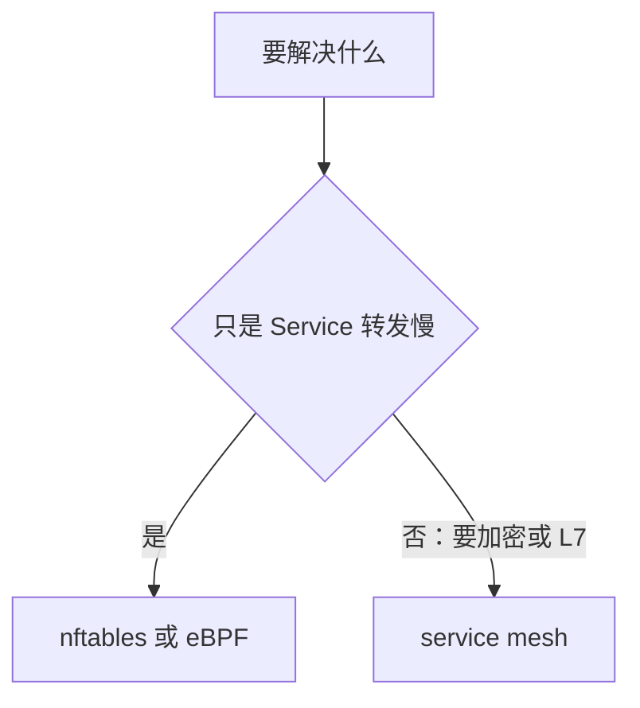

## Q
**该上哪一层**｜考点 · 必会

三个团队的诉求：A）有 6000 个 Service，iptables 规则同步太慢；B）监管要求所有服务间通信必须加密，应用不能改；C）想知道每对服务之间的请求延迟和错误率。各该考虑什么？为什么不是「全都上 service mesh」？

## A
| 诉求 | 最直接的手段 | 说明 |
|---|---|---|
| A. 规则同步慢 | 把 kube-proxy 换成 **nftables**；或使用自带 eBPF Service 转发的 CNI | 这是 **L4 Service 转发**的规模问题，不需要 mesh |
| B. 服务间加密、不改应用 | **service mesh**（mTLS） | 代理替应用做加密，策略集中配置 |
| C. 服务间的请求级指标 | mesh 的代理指标，或应用自己的 tracing 和 metrics | L7 的观测要有人解析请求 |

- **为什么不全上 mesh：** 每个 Pod（或 node）多一层代理，增加延迟、资源开销和故障点；对只需要 L4 转发的需求太重。
- **north/south 与 east/west：** Gateway 管集群外到内；mesh 管集群内部服务间。
- **别把层混了：** NetworkPolicy 管「谁能连谁」，不管加密和重试；mesh 管服务间通信行为，不替代 CNI。

出处

KIA2 §13.7（service mesh 定义；Gateway API 与 GAMMA）；kubernetes.io 博客 2025-02-28（nftables 对 iptables 的 O(n)→O(1)）

