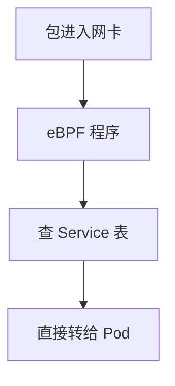

## Q
**eBPF dataplane 与 service mesh**｜摘要 · 必会

有些集群「不装 kube-proxy」，或者说用了 eBPF dataplane；还有 service mesh 里每个 Pod 带一个代理。它们各解决什么问题，代价是什么？

## A
**三个层次的流量控制，别混：**

| 层 | 例子 | 管什么 |
|---|---|---|
| **Service 转发**（L4） | kube-proxy（iptables、nftables） | ClusterIP → 后端 Pod |
| **NetworkPolicy** | CNI 实现 | 谁能连谁 |
| **service mesh**（L7，服务间） | 每个 Pod 的代理，或每 node 的代理 | 重试、超时、加密、按请求路由、观测 |

**eBPF**（在 Linux 内核里安全运行小程序的机制）：CNI 可以把转发和策略写成挂在内核网络路径上的 eBPF 程序，**代替**一长串 iptables 规则，用哈希表查找。

| | 好处 | 代价 |
|---|---|---|
| **eBPF dataplane** | 查找近似常数时间；可以绕过 iptables；策略和观测可更细 | 依赖较新的内核；要选定一个 CNI，换 CNI 就是大动作；排错要会看 eBPF 工具 |
| **service mesh** | 不改应用，就有 mTLS（双向 TLS）、重试、金丝雀、按请求的指标 | 多一层代理，增加延迟、资源和运维复杂度；配置对象多 |

- **service mesh：** 专门管服务到服务通信的基础设施层；配置可以通过 Gateway API 的 GAMMA 倡议统一表达。
- **选择：** 先用最简单的（kube-proxy 的 nftables + NetworkPolicy），遇到规模、策略或加密/观测的真实需求再引入 eBPF CNI 或 mesh。

出处

KIA2 §13.7（service mesh、north/south 与 east/west、GAMMA）；eBPF 与 kube-proxy 替代为通用网络知识，具体产品数据未收

