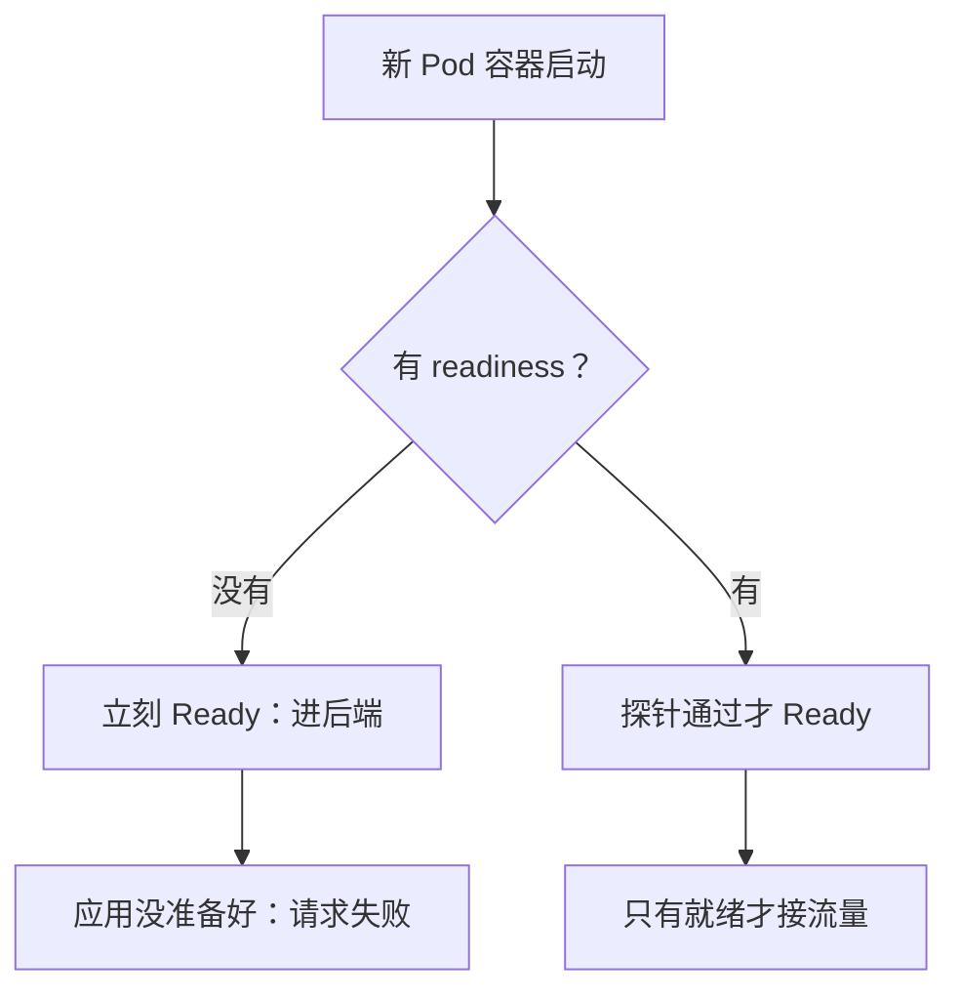

## Q
**EndpointSlice 与 readiness · 考点**｜考点 · 必会

滚动发布时，每次新 Pod 一出现就有一小段请求失败。新应用要 20 秒才能真正接请求，Pod 却在启动 1 秒后就被当成后端了。哪里没配对？怎么修？

## A
**原因：** 没有 readiness probe。Pod 的容器一启动，就被认为 Ready，立刻进了后端列表。



**修法：**

```yaml
readinessProbe:
  httpGet: {path: /ready, port: 8080}
  periodSeconds: 5
  failureThreshold: 3
```

| 配置 | 效果 |
|---|---|
| 加 readiness probe，`/ready` 在应用真正可服务时才返回 200 | 新 Pod 在探针通过前不进 EndpointSlice 的就绪列表 |
| 慢启动应用再加 startup probe | 避免启动阶段的探针被误判 |
| Deployment 的 `minReadySeconds` | 就绪后再稳定一段时间才算 available（第 5 部分） |

- **反过来：** 运行中依赖暂时不可用，readiness 失败，Pod 被临时摘掉，不被重启，故障过去后自动恢复。
- **要点：** readiness 是 Service 的「准入证」。

**出处：** KIA2 §11.3、§6.2；Poulton ch9
