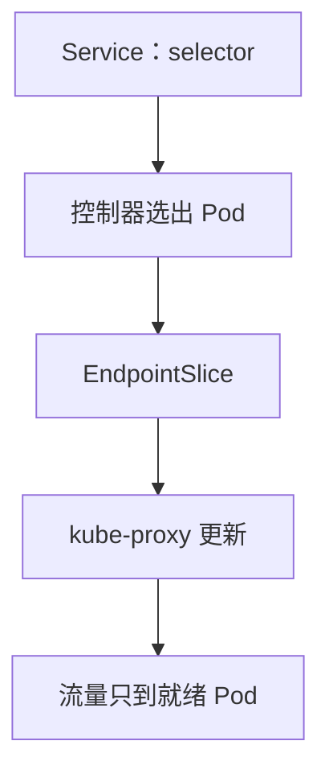

## Q
**EndpointSlice 与 readiness · 摘要**｜摘要 · 必会

Service 怎么知道现在有哪些 Pod 可以接流量？一个刚启动、还没准备好的 Pod 会被转发请求吗？

## A

| 对象 | 作用 |
|---|---|
| **EndpointSlice** | 一个 Service 当前后端的地址列表，每个地址带「是否就绪」；后端很多时拆成多个 slice |
| **Endpoints**（旧） | 早期的同类对象，所有地址在一个对象里；v1.33 起弃用，改用 EndpointSlice |
| **readiness probe** | 决定 Pod 的 Ready 状态，进而决定它能否进入 EndpointSlice 的就绪列表 |

- **规则：** Pod 的 Ready 为 True 才接流量。readiness probe 失败，Pod 从后端里摘掉，但不重启；恢复后加回来。
- **为什么拆 slice：** 一个 Service 有几千个后端时，旧的单个 Endpoints 对象每次变动都要整体发给所有 node；拆成多片后，一个 Pod 变化只更新一小片。
- **看一眼：** `kubectl get endpointslices -l kubernetes.io/service-name=kiada`。
- **不是所有后端都是 Pod：** Service 的 endpoint 可以是任何有 IP 的东西。

**出处：** KIA2 §11.3（Managing service endpoints）；Poulton ch9（kube-proxy 监听 Service 与 EndpointSlice）；Endpoints 弃用见 v1.33 发布博客
