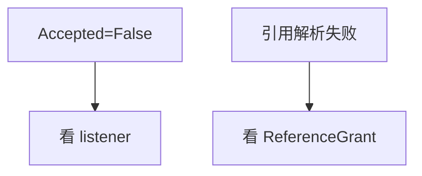

## Q
**Route 不生效 · 考点**｜考点 · 必会

两个现象：1）`kiada` namespace 里的 TCPRoute 绑定共享 Gateway，status 里 `Accepted` 为 False，原因 `NotAllowedByListeners`。2）HTTPRoute 的 backendRef 指向另一个 namespace 的 Service，`ResolvedRefs` 为 False，原因 `RefNotPermitted`。各缺什么？

## A
| 现象 | 缺什么 | 修法 |
|---|---|---|
| 1. Accepted=False，NotAllowedByListeners | Gateway 的那个 listener **没放行**这个 namespace（`allowedRoutes.namespaces.from` 默认是 `Same`，或者是 `Selector` 而该 namespace 没带对应 label） | 把 `from` 改为 `All`，或用 `Selector` 并给 namespace 打上约定 label（`kubectl label ns kiada part-of=kiada`） |
| 2. ResolvedRefs=False，RefNotPermitted | 目标 namespace 里没有 **ReferenceGrant** 允许这个来源引用 | 在 Service 所在 namespace 创建 ReferenceGrant，授权 `kiada` 的 HTTPRoute 引用该 Service |

- **一个好用的排查：** `kubectl get httproute NAME -o yaml`，读 `status.parents[].conditions` 里的 `reason` 和 `message`，它会直接说缺什么。
- **其他 reason：** `NoMatchingListenerHostname`（Gateway 没有 hostname 匹配的 listener）、`BackendNotFound`（引用的 Service 不存在）、`InvalidKind`（不支持的 kind）。
- **按 namespace 名放行：** 用 label key `kubernetes.io/metadata.name`。
- **为什么要两边都同意：** 防止一个 namespace 的用户把流量塞进别人的 Gateway，或者偷偷引用别人的 Service。

**出处：** KIA2 §13.3（表 13.2 route 条件）、§13.6.1–13.6.2
