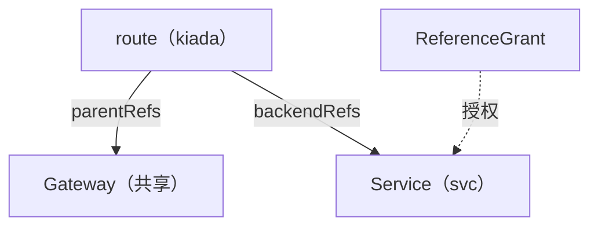

## Q
**跨 namespace、其他 Route 与 service mesh · 摘要**｜摘要 · 必会

Gateway API 里，route 怎么引用别的 namespace 的 Gateway 和 Service？除了 HTTP，还能路由什么？它和 service mesh 有什么关系？

## A
| 需求 | 做法 | 权限在谁手里 |
|---|---|---|
| route 绑定**别的 namespace 的 Gateway** | route 的 `parentRefs` 写 `namespace`；Gateway 的 listener 用 `allowedRoutes.namespaces.from` 放行：`Same`（默认）、`All`、`Selector`（按 namespace 的 label） | **Gateway 一方**决定谁能挂上来 |
| route 转给**别的 namespace 的 Service** | `backendRefs` 写 `namespace`；Service 所在 namespace 里创建 **ReferenceGrant** 授权 | **被引用方**决定 |

| Route 类型 | 用途 |
|---|---|
| HTTPRoute | HTTP / HTTPS，匹配、权重、filter |
| TLSRoute | TLS passthrough，按 SNI |
| **TCPRoute / UDPRoute** | 非 HTTP 的 TCP、UDP 服务，Gateway 里加对应协议的 listener（Ingress 做不到） |
| **GRPCRoute** | gRPC：listener 用 HTTP 协议，按服务和方法匹配 |

- **service mesh：** 专门负责服务之间通信的基础设施层，不用改应用就能管理流量。Gateway API 管的是入口（**north/south**，集群外到内）；同一套 API 稍加扩展也能管集群内服务之间（**east/west**），这就是 **GAMMA** 倡议：route 的 `parentRefs` 里把 `kind: Service`、`group: core` 当作父对象。
- **版本要核对：** 书里 TCPRoute 示例的 API 版本是 `v1alpha2`（尚在实验阶段），GRPCRoute 也不是每个实现都支持；用之前确认你选的实现支持哪些 Route。

**出处：** KIA2 §13.5–13.7
