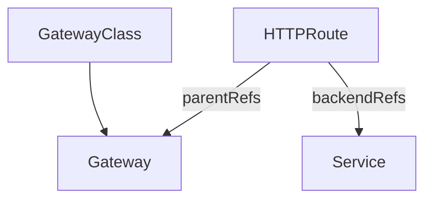

## Q
**GatewayClass、Gateway 与 HTTPRoute**｜摘要 · 必会

Gateway API 的三个核心对象各管什么？它们怎么连起来？

## A


| 对象 | 谁管 | 作用 |
|---|---|---|
| **GatewayClass** | 基础设施提供者 | 把 Gateway 和某个实现（控制器）关联起来 |
| **Gateway** | 集群运维 | 声明监听的端口、协议，控制器据此创建负载均衡器 |
| **HTTPRoute** | 应用开发者 | 路由规则：匹配主机名、路径、header，转发到哪些 Service |

```yaml
apiVersion: gateway.networking.k8s.io/v1
kind: HTTPRoute
metadata: {name: kiada}
spec:
  parentRefs:
  - name: my-gateway             # 挂在哪个 Gateway 上
  hostnames: ["kiada.example.com"]
  rules:
  - backendRefs:                 # 转发给谁
    - {name: kiada, port: 8080, weight: 1}
```

- **安装一个实现需要三样：** API 资源、Gateway 控制器（盯着新 Gateway 并部署）、一个或几个 GatewayClass。
- **关联靠引用：** HTTPRoute 用 `parentRefs` 指向 Gateway，用 `backendRefs` 指向 Service，对象之间没有嵌套。

<details class="pt" markdown="1"><summary>出处</summary>

Poulton ch8「How Gateway API works」；KIA2 ch13

</details>
