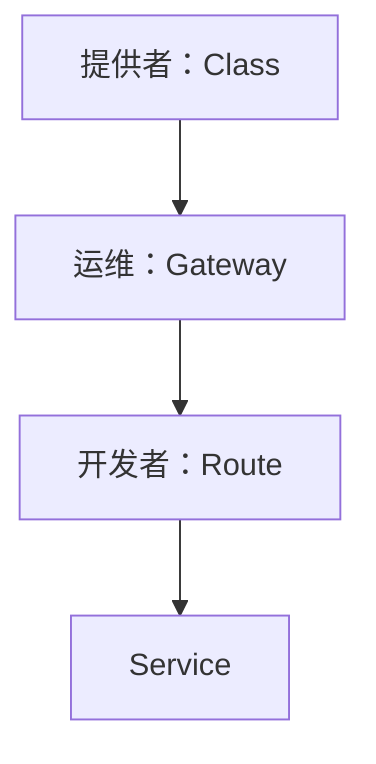

## Q
**为什么 Gateway API 取代 Ingress**｜摘要 · 必会

每个 LoadBalancer Service 要一个云负载均衡器，成本高。多个 HTTP 服务想共用一个入口，以前用 Ingress，现在推荐 Gateway API。它改进了什么？

## A
**一句话：** Ingress 把路由和入口基础设施揉在一个对象里，能力靠各家控制器的 annotation 扩展；Gateway API 按**角色**拆成几个对象，路由能力（权重、header 匹配）写在标准字段里。

| | Ingress | Gateway API |
|---|---|---|
| 对象 | 一个 Ingress | GatewayClass、Gateway、HTTPRoute 等 |
| 谁管什么 | 一个对象里什么都有 | 按角色拆开：谁提供基础设施、谁运维入口、谁写路由 |
| 高级路由 | 靠各控制器私有的 annotation，换控制器就不兼容 | 标准字段：header 匹配、权重切分 |
| 协议 | 主要 HTTP/HTTPS | HTTP、HTTPS、gRPC，TCP 和 UDP 在推进中 |
| 跨命名空间 | 不方便 | 支持跨命名空间路由 |

- **Gateway API 只是规范：** 没有默认实现，要自己装一个（Cilium、Envoy、Istio、NGINX、Traefik 等），写法大体通用。
- **云厂商预装的实现：** 可能是私有的，容易造成云锁定。
- **为什么要换：** Ingress 没有成为战略项目，长期缺乏投入，积累了不少安全隐患。

出处

Poulton ch8「Why no more Ingress」「How Gateway API works」；KIA2 ch13

