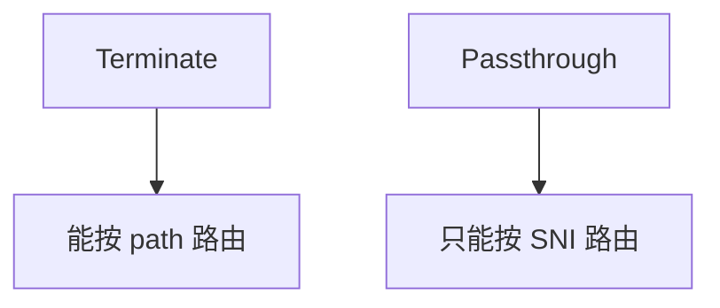

## Q
**权重与 TLS · 考点**｜考点 · 必会

1）HTTPRoute 的 backendRefs 写了 `stable` 权重 9、`new` 权重 1，各得多少流量？两项都不写 `weight` 呢？2）Gateway 做 TLS 终止和 passthrough，对「能不能按 URL 路径路由」各有什么影响？

## A
**1）权重：** 份额 = 自己的权重 / 所有权重之和。

| 写法 | 流量 |
|---|---|
| stable 9、new 1（总和 10） | 90% / 10% |
| 都不写 `weight` | 平分，各 50% |

金丝雀常用这种写法：新版本先给很小的权重，观察没问题再逐步加大。

**2）TLS：**

| | Terminate | Passthrough |
|---|---|---|
| Gateway 是否解密 | 是 | **否** |
| 能看到什么 | 完整的 HTTP 请求，能按 path、header 路由，能用 filter | 只有 TLS 握手里的 **SNI 主机名** |
| 后端收到 | 明文 HTTP | 原始 TLS，由后端自己解密（要有证书） |
| 路由对象 | HTTPRoute | TLSRoute（只能按 SNI 选后端和权重） |

- **需要端到端加密：** 选 passthrough，或终止后再重新加密（后端自己也有 TLS）。
- **需要路径路由和 header 改写：** 必须 Terminate。

**出处：** KIA2 §13.3.2（权重 9:1；不写 weight 则平分）、§13.4（Terminate 与 Passthrough，SNI）
