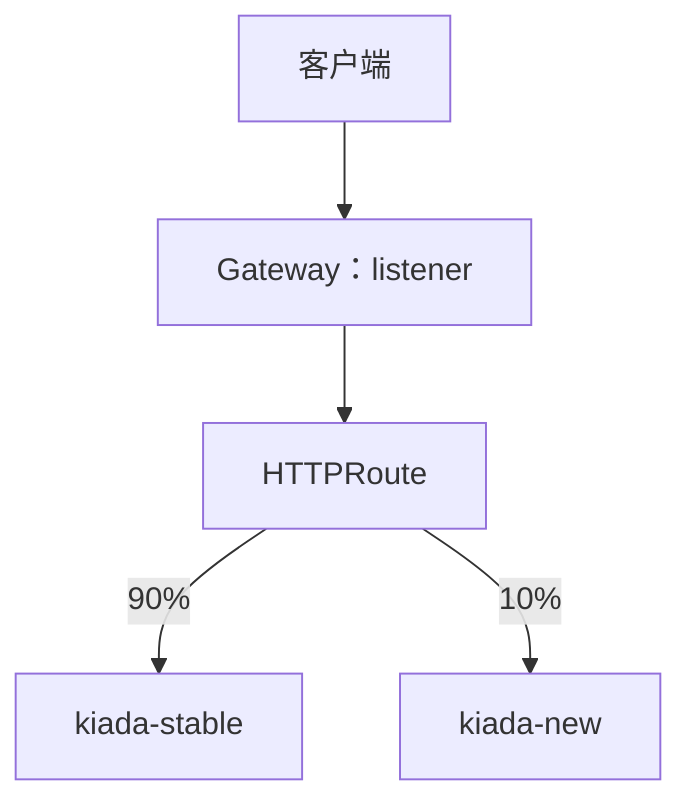

## Q
**HTTPRoute 的权重、匹配、filter 与 TLS**｜摘要 · 必会

用 Gateway API 做金丝雀发布（90% 老版本、10% 新版本）、按 header 路由、改请求头、给入口加 HTTPS，各写在哪里？

## A
```yaml
apiVersion: gateway.networking.k8s.io/v1
kind: HTTPRoute
metadata: {name: kiada}
spec:
  parentRefs: [{name: kiada}]            # 绑定到哪个 Gateway
  rules:
  - matches:
    - headers: [{name: Release, value: new}]   # 满足全部条件才命中
    backendRefs: [{name: kiada-new, port: 80}]
  - backendRefs:                         # 默认：按权重切分
    - {name: kiada-stable, port: 80, weight: 9}
    - {name: kiada-new, port: 80, weight: 1}
    filters:
    - type: RequestHeaderModifier
      requestHeaderModifier:
        set: [{name: set-by-gateway, value: hello}]
```

| 能力 | 写在哪 | 说明 |
|---|---|---|
| **权重切分** | `backendRefs[].weight` | 份额 = 本项权重 / 总权重；不写 `weight` 则平分 |
| **请求匹配** | `rules[].matches` | 可按 HTTP method、header、path、query 参数；一项里所有条件都满足才命中 |
| **filter** | `rules[].filters` | 改请求头 / 响应头（`add` 追加、`set` 覆盖、`remove` 删）、URL 重写、重定向、镜像请求到别的后端 |
| **TLS 终止** | Gateway 的 listener：`tls.mode: Terminate`，`certificateRefs` 指向 Secret | Gateway 解密后以明文 HTTP 转给后端 |
| **TLS passthrough** | listener：`tls.mode: Passthrough` + `TLSRoute` | Gateway **不解密**，只能看到 SNI（目标主机名），按它路由 |



- **金丝雀要两个 Service：** 一个只指向稳定版，一个只指向新版；否则一个选了两版 Pod 的 Service 没法精确控比例。
- **和 Ingress 的区别：** 这些都是标准字段，不靠 controller 私有的 annotation。
- **状态：** 看 Route 的 `status.parents[].conditions`，`Accepted`、`ResolvedRefs` 说明是否被接受、引用是否有效。

<details class="pt" markdown="1"><summary>出处</summary>

KIA2 §13.3.2–13.3.4、§13.4.1–13.4.2

</details>
