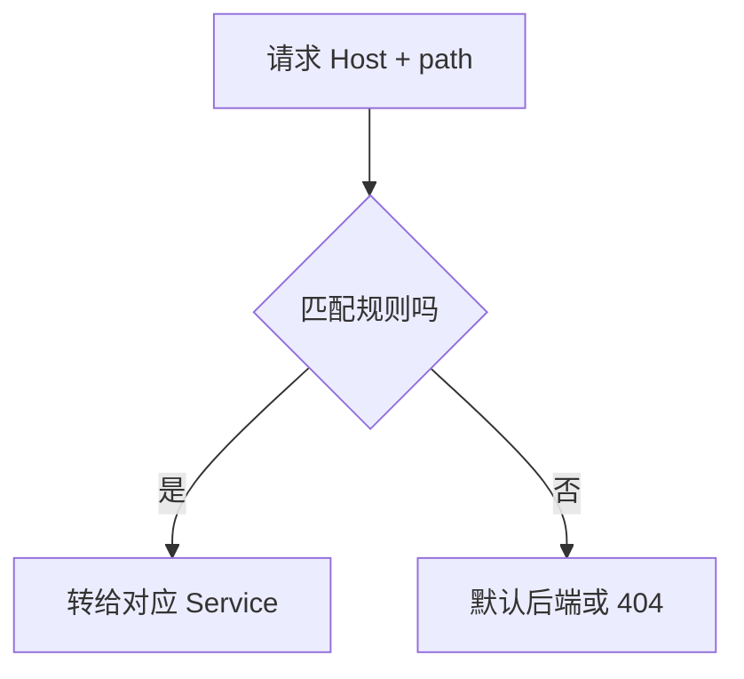

## Q
**Ingress 没反应 · 考点**｜考点 · 必会

你创建了 Ingress，`kubectl get ingress` 的 ADDRESS 列一直是空的；另一次有了 IP，但用 `curl http://<IP>/` 得到 404，而 `curl --resolve kiada.example.com:80:<IP> http://kiada.example.com/` 就正常。各是什么原因？

## A
| 现象 | 原因 | 怎么查 |
|---|---|---|
| ADDRESS 一直空 | 没有 controller 处理这个 Ingress：根本没装 controller；或者装了多个 controller，Ingress 没指定 `ingressClassName`，大家都没认领 | `kubectl get pods -A` 找 controller；`kubectl get ingressclasses`；Ingress 里写上 `ingressClassName` |
| 直接用 IP 访问 404 | Ingress 靠请求里的 **Host 头**做虚拟主机路由，Host 对不上任何规则 | 用 `curl --resolve host:80:IP`，或在 `/etc/hosts` 加记录 |
| 本地集群看到的地址是 `localhost` | Minikube 在 VM 里时显示的是 VM 视角的地址 | `minikube ip` |

- **规则怎么选：** 同时匹配多个 path 时，`Exact` 优先；没有任何规则命中，走 **default backend**（可指向自定义 404 服务），都没有就 404。
- **DNS：** 生产里把域名的 DNS 记录指向 Ingress 的 IP。
- **排查顺序：** controller 在不在 → Ingress 有没有地址 → Host 对不对 → 后端 Service 有没有 EndpointSlice。

**出处：** KIA2 §12.2.1（地址为空、Host 头、`--resolve`）、§12.2.2、§12.2.4（default backend）
