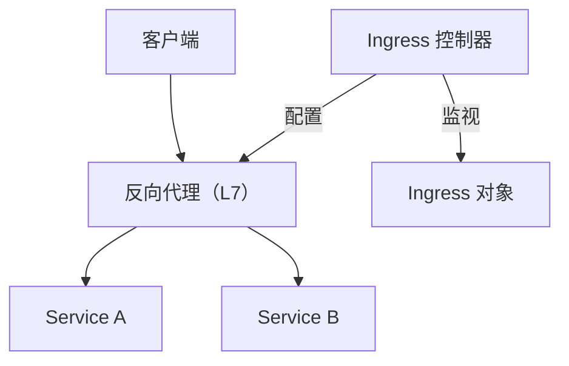

## Q
**Ingress 与 Ingress controller · 摘要**｜摘要 · 必会

LoadBalancer Service 每个服务要一个负载均衡器。Ingress 怎么让多个 HTTP 服务共用一个入口？它由哪几部分组成，缺哪个都不行？

## A
**Ingress** 是让集群外的客户端访问集群里的 HTTP(S) 服务的一种方式，由**三个组件**共同完成：

| 组件 | 是什么 |
|---|---|
| **Ingress 对象** | API 对象，写路由规则：什么 host 和 path 转给哪个 Service |
| **L7 负载均衡器 / 反向代理** | 真正转发 HTTP 流量的进程（如 NGINX、Envoy、云厂商的 LB） |
| **Ingress controller** | 盯着 API 里的 Ingress 对象，部署并配置上面的代理 |



```yaml
apiVersion: networking.k8s.io/v1
kind: Ingress
metadata: {name: api-example-com}
spec:
  ingressClassName: nginx
  rules:
  - host: api.example.com
    http:
      paths:
      - {path: /quote, pathType: Exact, backend: {service: {name: quote, port: {name: http}}}}
      - {path: /questions, pathType: Prefix, backend: {service: {name: quiz, port: {name: http}}}}
```

- **L7 vs L4：** Service（LoadBalancer）工作在第 4 层（TCP/UDP），不看 HTTP 内容；Ingress 在第 7 层，能按 host、path 路由，还能做 TLS 终止、cookie 会话保持、URL 改写这类 Service 做不到的事。
- **controller 要自己装：** 集群默认不带；没装，Ingress 对象就没有人处理。
- **后端 Service：** 通常用 ClusterIP 就行（有的实现要求 NodePort）。
- **默认没有 URL 改写：** 请求的 path 原样转给后端。
- **多个 Ingress：** 每个通常有自己的 IP，也有实现用共享入口。

**出处：** KIA2 §12.1.1–12.1.2、§12.2.2
