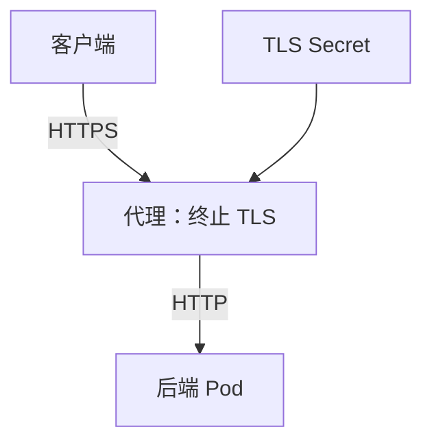

## Q
**Ingress 的 TLS、annotation 与 IngressClass**｜摘要 · 必会

怎么让 Ingress 提供 HTTPS？Ingress 之外的能力（会话保持、重写等）怎么配？有多个 controller 时由谁处理？

## A

| 主题 | 做法 |
|---|---|
| **TLS 终止**（标准） | `spec.tls` 里写 `secretName` 和 `hosts`；Secret 用 `kubectl create secret tls NAME --cert=… --key=…` 创建，键是 `tls.crt`、`tls.key` |
| **TLS passthrough**（不解密，交给后端） | Kubernetes **没有标准写法**，要看 controller，通常靠 annotation（如 NGINX 的 `ssl-passthrough: "true"`，且 controller 需用 `--enable-ssl-passthrough` 启动） |
| **其他能力** | 靠 **annotation**，如 `nginx.ingress.kubernetes.io/affinity: cookie`；前缀说明属于哪个 controller，别的实现会忽略它 |
| **哪个 controller 处理** | **IngressClass** 对象（`spec.controller` 指定 controller），Ingress 用 `spec.ingressClassName` 引用它；一个集群可以装多个 controller |
| **非 Service 后端** | `backend.resource` 引用某个自定义资源（少数 controller 支持），把路由规则放在自定义对象里 |

- **Service 做不到而 Ingress 可以：** 基于 cookie 的会话保持（Service 只能按客户端 IP）。
- **annotation 的代价：** 同一个功能每家 controller 写法不同，换 controller 就要重写，也是 Gateway API 想解决的问题。
- **没写 `ingressClassName`：** 若集群有默认 IngressClass 就用它；否则可能没有 controller 认领。
- **path 匹配：** `pathType` 必须写：`Exact`（完全相等）、`Prefix`（按 `/` 分段的前缀）、`ImplementationSpecific`（由 controller 决定）。

出处

KIA2 §12.3–12.6；kubernetes.io Concepts › Ingress（pathType、default IngressClass）

