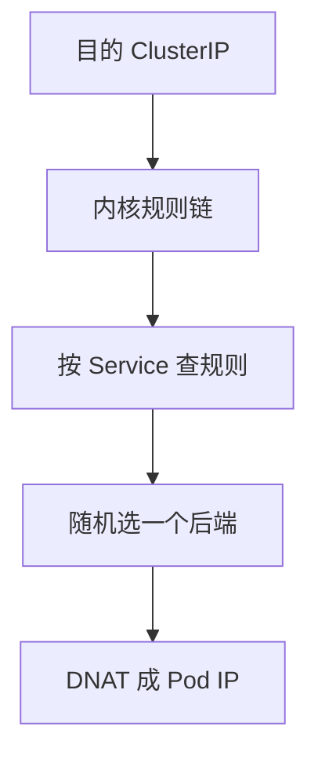

## Q
**kube-proxy 与 Service 的 dataplane**｜摘要 · 必会

ClusterIP 是个虚拟 IP，没有任何进程监听它。流量到底是怎么被转给某个 Pod 的？iptables、ipvs、nftables 三种模式有什么区别？

## A
**机制：** kube-proxy 在每个 node 上盯着 Service 和 EndpointSlice，把「目的地是这个 ClusterIP:port 的包，改写成某个后端 Pod 的 IP:port（DNAT）」的规则写进**内核**，包在内核里就被改写转走了，不经过 kube-proxy 进程。

| 模式 | 做法 | 状态 |
|---|---|---|
| **iptables** | 每个 Service 和每个端点装若干条 iptables 规则；包要**顺序**检查，开销随 Service 数量 **O(n)** 增长；规则数量大时同步更新慢 | 默认（v1.37 文档中仍是默认；将来会改成 nftables） |
| **ipvs** | 内核 IPVS，用哈希表，有多种调度算法（rr、lc、sh 等） | **v1.35 弃用**；文档称将在 v1.40 起默认关闭、v1.43 移除 |
| **nftables** | 内核新一代 nftables，Service 查找用 map，约 **O(1)**，规则同步只更新变化的部分 | **v1.33 GA**，是 ipvs 的推荐替代 |

- **不是代理：** 名字叫 proxy 是历史原因；现在它是「规则同步器」。
- **查看：** iptables 模式下 `iptables -t nat -L KUBE-SERVICES` 可看到每个 Service 一条规则（链名里有哈希）。
- **相关策略：** `externalTrafficPolicy`、`internalTrafficPolicy` 都是 kube-proxy 在生成这些规则时遵守的。
- **所以：** 大集群（成千上万个 Service）选 nftables；Windows node 只有 `kernelspace` 模式。

出处

kubernetes.io Reference › Virtual IPs and Service Proxies；kubernetes.io 博客 2025-02-28「NFTables mode for kube-proxy」；发布博客 v1.33、v1.35

