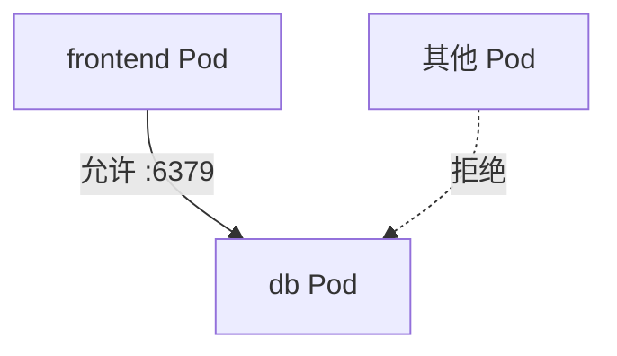

## Q
**NetworkPolicy · 摘要**｜摘要 · 必会

集群里默认任何 Pod 都能连任何 Pod。想让 `db` 只接受 `frontend` 的连接，用什么？它的规则怎么叠加？

## A
**一句话：** 默认**全通**。**NetworkPolicy** 把它变成**白名单**：一个 Pod 一旦被某个策略选中，只有策略里允许的连接才能通过。

```yaml
apiVersion: networking.k8s.io/v1
kind: NetworkPolicy
metadata: {name: db-allow-frontend}
spec:
  podSelector:
    matchLabels: {role: db}        # 这条策略管谁
  policyTypes: [Ingress]
  ingress:
  - from:
    - podSelector:
        matchLabels: {role: frontend}
    ports:
    - {protocol: TCP, port: 6379}
```



| 规则 | 说明 |
|---|---|
| 默认 | 没有任何策略选中的 Pod：入站出站都放行 |
| 被选中 | 在 `policyTypes` 里列了 `Ingress`，入站就只放行 `ingress` 规则允许的；`Egress` 同理，两个方向各自独立 |
| 叠加 | 多个策略都选中同一个 Pod，允许的是并集，没有顺序，也没有冲突 |
| 双方都要允许 | A 连 B：A 的出站和 B 的入站都得放行 |
| 回包 | 已允许连接的回程流量自动放行 |
| 来源写法 | `podSelector`、`namespaceSelector`、`ipBlock` |

- **谁来执行：** 由网络插件（**CNI**）实现。集群的网络插件不支持，创建了 NetworkPolicy 也**不起作用**，没有任何提示。
- **全拒绝：** `podSelector: {}` 加 `policyTypes: [Ingress]` 且没有规则，就是该命名空间默认拒绝所有入站。

**出处：** kubernetes.io Concepts › Network Policies
