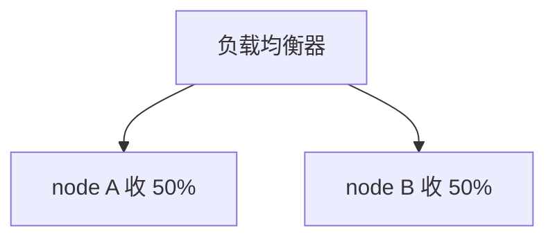

## Q
**externalTrafficPolicy · 考点**｜考点 · 必会

LoadBalancer Service 的后端有 3 个 Pod：node A 上 1 个，node B 上 2 个。云负载均衡器把流量平分给 node A 和 node B。`externalTrafficPolicy` 分别设成 `Cluster` 和 `Local`，每个 Pod 收到多少流量？客户端 IP 能看到吗？

## A
| | `Cluster`（默认） | `Local` |
|---|---|---|
| node 收到流量后 | 转发给**所有** Pod，可能跨 node | 只转发给**本 node 上**的 Pod |
| 每个 Pod 的占比 | 各 1/3 | A 上的 Pod 50%，B 上的两个各 25% |
| 额外一跳 | 有，多一次网络跳转，延迟增加 | 没有 |
| 客户端 IP | **被替换**成转发 node 的 IP，应用看不到真实来源 | **保留**真实客户端 IP |
| 代价 | 看不到客户端 IP | 流量可能分布不均；node 上没有本地 Pod 时，连到它的请求会挂住 |

- **Local 要配套：** 负载均衡器要通过 `healthCheckNodePort` 检查哪些 node 上有后端，只把流量发给有 Pod 的 node，否则请求会挂住。
- **为什么 Cluster 要换源 IP：** 回包必须沿原路回到最初接收连接的 node，所以转发时把源 IP 换成该 node 的 IP。
- **选择：** 需要真实客户端 IP（日志、风控）或想少一跳，选 Local；要均匀分布、省心，选 Cluster。

**出处：** KIA2 §11.2（externalTrafficPolicy：Cluster 与 Local 的对比，图 11.10）
