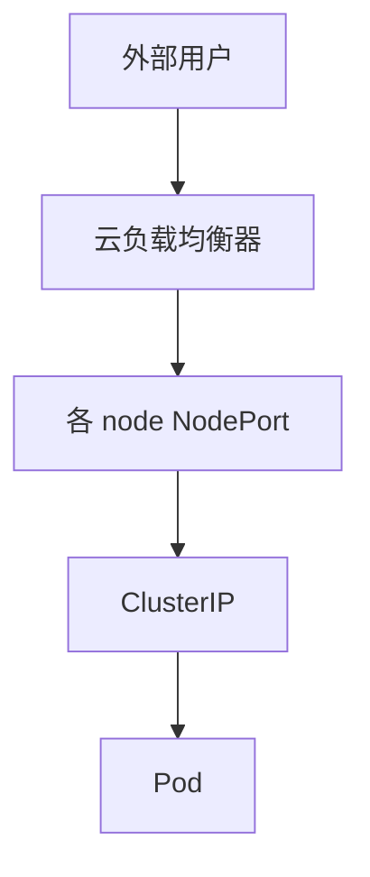

## Q
**NodePort 与 LoadBalancer**｜摘要 · 必会

ClusterIP 只能在集群里访问。外面的用户怎么访问到 Pod？NodePort 和 LoadBalancer 各是什么？

## A
**一句话：** 三种类型是一层套一层：LoadBalancer 建立在 NodePort 上，NodePort 建立在 ClusterIP 上。

| 类型 | 怎么访问 | 说明 |
|---|---|---|
| ClusterIP | 集群内 | 默认 |
| **NodePort** | `任意 node 的 IP:nodePort` | 每个 node 都开同一个端口，端口范围一般是 30000–32767 |
| **LoadBalancer** | 云负载均衡器的外部 IP | 向云基础设施申请一个负载均衡器，转发到各 node 的 NodePort |

- **Kubernetes 不自带负载均衡器：** LoadBalancer 类型是向云申请一个。申请到之前，`EXTERNAL-IP` 显示 `<pending>`；自建集群没有云就一直是 `<pending>`。
- **云上用 NodePort 直连：** 防火墙要放行 30000–32767。
- **一个 Service 一个负载均衡器：** 服务多了成本高。多个 HTTP 服务共用一个入口，用 Gateway API（下面）。

出处

KIA2 §11.2（Making services available externally）、§3.3

