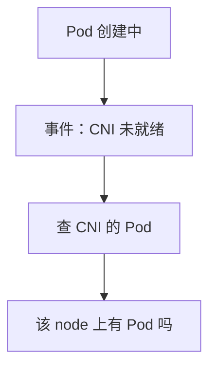

## Q
**Pod 之间不通**｜考点 · 必会

新装的集群里所有 Pod 都起不来，`kubectl describe pod` 事件里有「network plugin not ready / cni not initialized」，node 也是 `NotReady`。又一个情形：集群升级后，Pod 的 IP 和 Service 的 IP 段发生了重叠。各是什么问题，怎么排查？

## A
| 现象 | 说明 | 排查 |
|---|---|---|
| node `NotReady`，Pod 卡在 `ContainerCreating`，提示 CNI 未初始化 | **没装 CNI 插件**，或装了但在这个 node 上没有起来；没有它，runtime 没法给 Pod 配网络 | `kubectl get pods -n kube-system -o wide` 看 CNI 的 DaemonSet（每个 node 一个 Pod 的 workload）是否每个 node 都有 Pod；看 node 上 CNI 配置目录里有没有文件；看 runtime 和 kubelet 日志 |
| Pod IP 与 Service IP 重叠 | Pod 的地址范围由 **CNI** 配置，Service 的由 **API server** 配置，两边没有协调，必须保证**不重叠** | 对照 CNI 的 Pod CIDR 和 API server 的 service CIDR（`kubectl cluster-info dump` 或看启动参数） |
| 同 node 能通、跨 node 不通 | 违反「所有 Pod 能直接通信」的规则；多半是 CNI 的跨 node 路径（路由或封装）出问题，或 node 之间的底层网络/安全组拦了 | 在两个 node 上起测试 Pod 互 ping；查 node 间的防火墙 |

- **不要指望 kube-proxy 修这个：** 它只管 Service 的转发，Pod 到 Pod 的连通在 CNI 这一层。
- **经验：** 装集群时第一件事是装 CNI；`kube-system` 里 CoreDNS 的 Pod 先 Pending 往往也是同一个原因。

出处

kubernetes.io Concepts › Network Plugins（需要 CNI 插件；runtime 加载 CNI；v1.24 起不由 kubelet 管理）、Cluster Networking（IP 段不重叠）；排查步骤为常规做法

