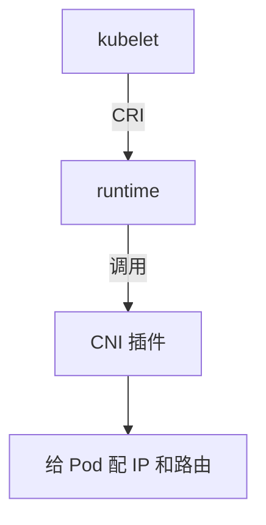

## Q
**Pod network model 与 CNI · 摘要**｜摘要 · 必会

Kubernetes 对 Pod 网络提出了什么要求？是谁来实现它？

## A
**四个要解决的问题：** 同一 Pod 里容器之间（`localhost`）；Pod 到 Pod；Pod 到 Service；集群外到 Service。这里讲第二个。

**Kubernetes 网络模型（规则）：**

| 规则 | 含义 |
|---|---|
| 每个 Pod 有**自己的 IP** | 不用做端口映射协调，每个 Pod 有一整个端口空间 |
| **所有 Pod 之间能直接通信** | 不论同 node 还是跨 node，**不经过代理，也不做地址转换（NAT）** |
| node 上的 agent（kubelet 等）能访问本 node 的所有 Pod | — |

- **谁实现：** Kubernetes 自己不实现，而是靠 **CNI**（Container Network Interface）插件。集群**必须**装一个与版本兼容的 CNI 插件。
- **谁调用：** container runtime 在创建 Pod 沙箱时加载并调用 CNI 插件；自 v1.24 起 kubelet 不再管理 CNI（相关的命令行参数被移除）。
- **IP 段要求：** Pod、Service、Node 需要**互不重叠**的地址范围：CNI 管 Pod 的，API server 管 Service 的。
- **NetworkPolicy** 也要 CNI 支持，没有支持的插件，创建了也不会生效（见后面的卡）。
- **选哪个插件：** 开源和商业的都有，按需选；本卡不比较具体产品。

**出处：** kubernetes.io Concepts › Cluster Networking；Services, Load Balancing, and Networking；Network Plugins
