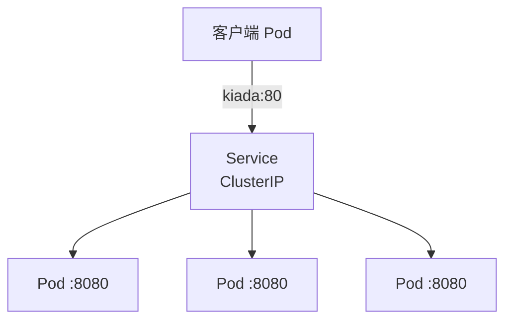

## Q
**Service 与 ClusterIP · 摘要**｜摘要 · 必会

三个 Pod 是 `app=kiada` 的后端，它们的 IP 随时会变。别的 Pod 怎么稳定地访问它们？Service 具体怎么工作？

## A
**一句话：** **Service** 给一组 Pod 一个不变的虚拟 IP（**ClusterIP**）和一个 DNS 名字，访问它的流量被转发到当前健康的后端 Pod。

```yaml
apiVersion: v1
kind: Service
metadata: {name: kiada}
spec:
  selector: {app: kiada}   # 选出后端 Pod
  ports:
  - port: 80               # Service 自己对外的端口
    targetPort: 8080       # 转发到 Pod 的哪个端口
```



| 概念 | 说明 |
|---|---|
| ClusterIP | 只在集群内部可达的虚拟 IP，默认类型；没有哪台机器真的拥有它 |
| selector | 用标签选后端 Pod |
| `port` / `targetPort` | Service 的端口 / 后端 Pod 的端口，可以不同 |
| DNS 名 | 同命名空间里直接 `kiada`；跨命名空间 `kiada.<命名空间>` |
| 谁来转发 | 每个 node 上的 **kube-proxy** 监听 Service 和 EndpointSlice（记录 Service 背后有哪些 Pod 地址的对象，下一张细讲），在内核里写规则，把发往 ClusterIP 的流量改写到某个 Pod IP |

- **ClusterIP 是虚拟的：** 它所在的「服务网络」没有路由，流量靠 node 内核里的规则拦截并转发。
- **后端换了：** Pod 增删后，规则更新，客户端仍然用同一个地址。

**出处：** KIA2 §11.1（Exposing pods with services）；Poulton ch9「ClusterIP routing」
