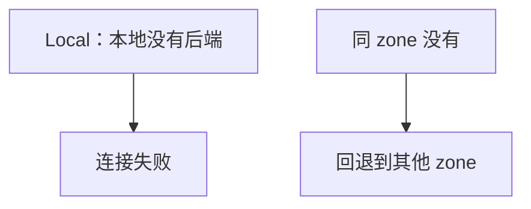

## Q
**Local 把应用搞挂了**｜考点 · 必会

团队为了省跨 zone 流量，给一个普通后端 Service 设了 `internalTrafficPolicy: Local`。上线后，没有该后端 Pod 的 node 上的客户端全部连接失败。为什么？应该怎么改？

## A
| 问题 | 原因 |
|---|---|
| 没有本地后端的 node 上请求失败 | `Local` 是**硬规则**：对这个 node 上的客户端，Service 表现为零后端，哪怕别的 node 上有健康的 Pod |

| 想要的是 | 该用 |
|---|---|
| 「必须只用本机的，没有就失败」（每 node 一个系统 Pod 的场景） | `internalTrafficPolicy: Local`，并保证每个 node 都有后端（用 DaemonSet（每个 node 跑一个 Pod 的 workload）） |
| 「尽量同 zone，不行再跨 zone」 | `trafficDistribution: PreferSameZone` |
| 「尽量同 node，不行再走远端」 | `trafficDistribution: PreferSameNode`（v1.35 GA） |

- **验证：** 在某个客户端 Pod 里循环 `curl`，看回包里的 Pod 名和 node 名；`kubectl get pods -o wide` 对照所在 node。
- **别用 Local 来「优化」普通服务：** 它是语义保证，不是性能开关。
- **EndpointSlice 里能看到：** 就近偏好相关的 hints 写在 `endpoints[].hints.forZones`。

出处

KIA2 §11.5.1「if no node-local service endpoints, the connection fails」；kubernetes.io Concepts › Service（trafficDistribution 取值）

